# การทดลองที่ 1: ติดตั้ง DevStack บน Ubuntu 24.04

## วัตถุประสงค์

ติดตั้งสภาพแวดล้อม OpenStack แบบ All-in-One บน Ubuntu 24.04 โดยใช้ DevStack บน Virtual Machine ที่สร้างจาก [Lab 0: ติดตั้ง Ubuntu 24.04 บน Hyper-V](lab00-centos-hyperv.md)

---

## ข้อกำหนด

| รายการ | ข้อกำหนด |
|--------|-----------|
| ระบบปฏิบัติการ | Ubuntu 24.04 (ติดตั้งจาก Lab 0) |
| หน่วยความจำ (RAM) | 8 GB (8192 MB) |
| ดิสก์ | 60 GB |
| ผู้ใช้ | `stack` (non-root พร้อม sudo NOPASSWD) |
| เครือข่าย | 3 adapters ตามที่ตั้งค่าใน Lab 0 |

---

## Step 1: เตรียมระบบ

### Powershell Administrator
- เปิดการใช้งาน  Nested Hyper-V virtualization เพื่อให้ VM เข้าถึงชั้นของ Hypervisor ได้โดยตรง จำเป็นต้องทำ

```
# 1. ตรวจสอบสถานะVirtual Machine (ต้องเป็น Off)
Get-VM -Name "DevStackUbuntu2404"

# 2. ปิดVirtual Machineให้สนิท (ถ้ายังไม่ Off)
Stop-VM -Name "DevStackUbuntu2404" -Force

# 3. เปิดใช้งาน Nested Virtualization (คำสั่งหลัก)
Set-VMProcessor -VMName "DevStackUbuntu2404" -ExposeVirtualizationExtensions $true

# 4. เปิด MAC Address Spoofing (จำเป็นสำหรับ nested VM ออกเครือข่าย)
Get-VMNetworkAdapter -VMName "DevStackUbuntu2404" | Set-VMNetworkAdapter -MacAddressSpoofing On

# 5. ตรวจสอบว่าเปิด Nested Virtualization สำเร็จ
Get-VMProcessor -VMName "DevStackUbuntu2404" | Select-Object ExposeVirtualizationExtensions

# 6. ตรวจสอบว่า MAC Spoofing เปิดอยู่
Get-VMNetworkAdapter -VMName "DevStackUbuntu2404" | Select-Object Name, MacAddressSpoofing

# 7. เปิด Virtual Machine กลับมา
Start-VM -Name "DevStackUbuntu2404"
```


!!! note  "หมายเหตุ คำสั่ง linux ที่ใช้ ทดสอบ จะเป็นดูค่าของ  vmx  สำหรับ intel,  svm สำหรับ AMD และ kvm"
    grep -E 'vmx|svm' /proc/cpuinfo  
    lscpu | grep -i virtualization  
    lsmod | grep kvm


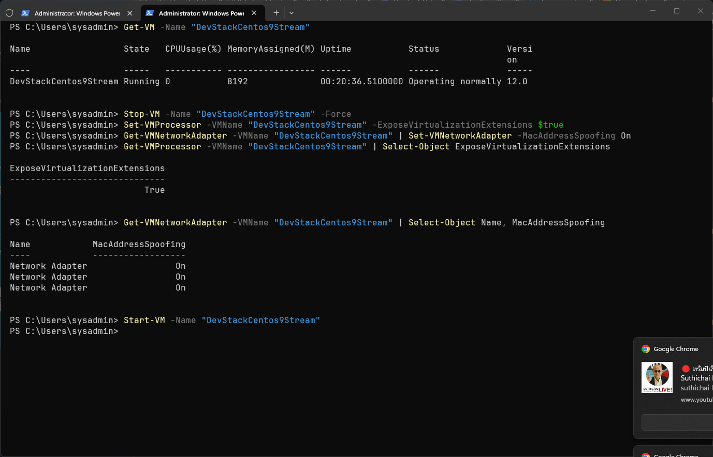


## การสร้าง บัญชีผู้ใช้ stack สำหรับ การ Run Devstack
[https://docs.openstack.org/devstack/latest/](https://docs.openstack.org/devstack/latest/)
### 1 Log in เข้า Server
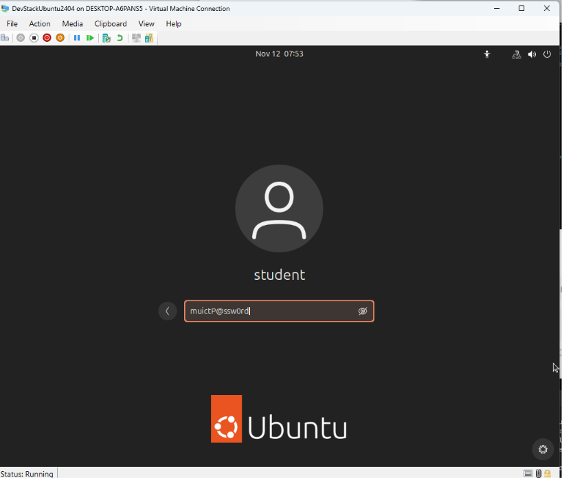

```bash
# login gui ด้วย user  student  password  muictP@ssw0rd
```

### 2 เปิด linux Terminal ตรวจสอบ  network ด้วยคำสั่ง ip a

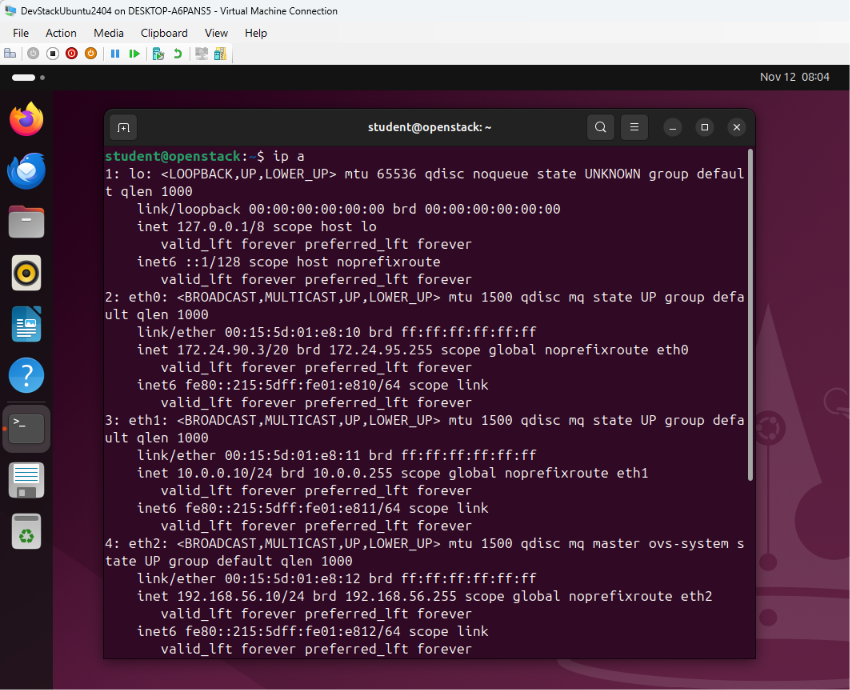


- ตรวจสอบ  network card ของ ubuntu ว่า ออก หรือไม่
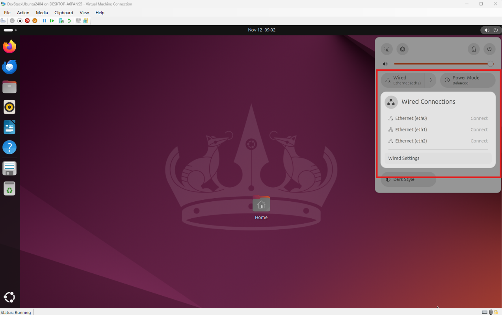

!!! tip  "SSH จาก Windows"
    สามารถเข้าใช้ โดยการ ssh จาก Window terminal จะสะดวก ง่ายกว่าในการ Copy-Paste.
    ให้เข้าใช้งาน ไปที่ Ubuntu Server สามารถ เปิด ผ่าน GUI แต่แนะนำ ให้เข้าผ่าน Window Termial ssh เข้าไป  ip 172.24.90.3  (ip eth0 คามรูปด้านบน แต่เครื่องแต่ละเครื่องจะต่างกัน)


### 2 สร้าง stack user
- การเอกสารการติดตั้ง Devstack [https://docs.openstack.org/devstack/latest/](https://docs.openstack.org/devstack/latest/)  แนะนำให้มีการสร้าง user เฉพาะในการ ติดตั้ง Devstack
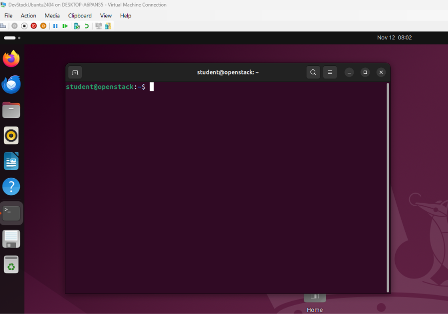

```bash
# Add Stack user
sudo useradd -s /bin/bash -d /opt/stack -m stack

# เปลี่ยน Executable Permisstion
sudo chmod +x /opt/stack

# เปลี่ยน File permision  
chmod -R 750 /opt/stack

# เปิด terminal แล้ว สลับ user เป็น stack
echo "stack ALL=(ALL) NOPASSWD: ALL" | sudo tee /etc/sudoers.d/stack
sudo -u stack -i
```


```
ssh stack@172.24.84.37
```
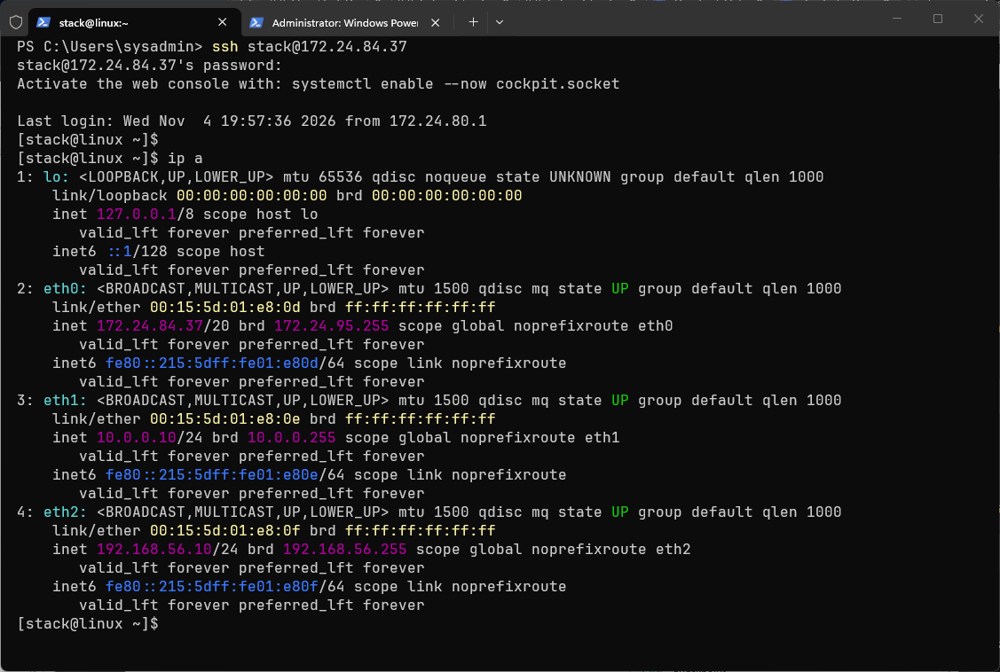

ควรเห็น 3 interfaces:
- `eth0`: IP จาก DHCP (hyper-v) และ ได้ทำการเปลี่ยนให้เป็น Static ip แล้ว 172.24.84.37
- `eth1`: 10.0.0.10 (Management)
- `eth2`: 192.168.56.10 (External / สำหรับ br-ex)


- เราได้สร้าง user stack ตั้งแต่ สร้าง VM ใน hyperV เรียบร้อย
```bash
echo "stack ALL=(ALL) NOPASSWD: ALL" | sudo tee /etc/sudoers.d/stack
sudo -u stack -i
```

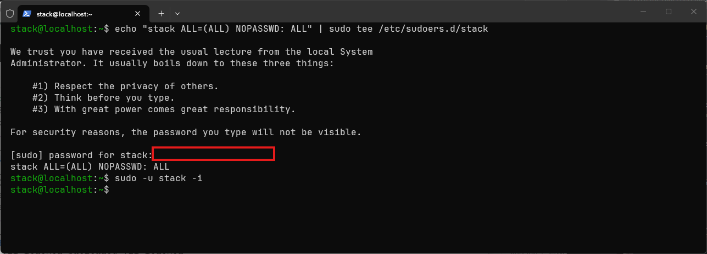

หรือหาก VM ยังไม่ได้สร้างผู้ใช้ stack: (lab ข้ามข้อนี้) เช่นในกรณีที่ linux server มี user ชื่อ stack

```bash
sudo useradd -s /bin/bash -d /opt/stack -m stack
echo "stack ALL=(ALL) NOPASSWD: ALL" | sudo tee /etc/sudoers.d/stack
sudo -u stack -i
```


---

## Step 2: Clone DevStack และ ทำงานใน Branch stable
- เนื้อหาหลัก [https://docs.openstack.org/devstack/latest/](https://docs.openstack.org/devstack/latest/)

```bash
sudo chmod 755 /opt/stack
cd /opt/stack
git clone https://opendev.org/openstack/devstack

cd devstack
git branch -a

# checkout code branch stable
git checkout stable/2026.2

# ยืนยันว่าว่าอยู่บน Branch stable/2026.2 จริง
git branch
```
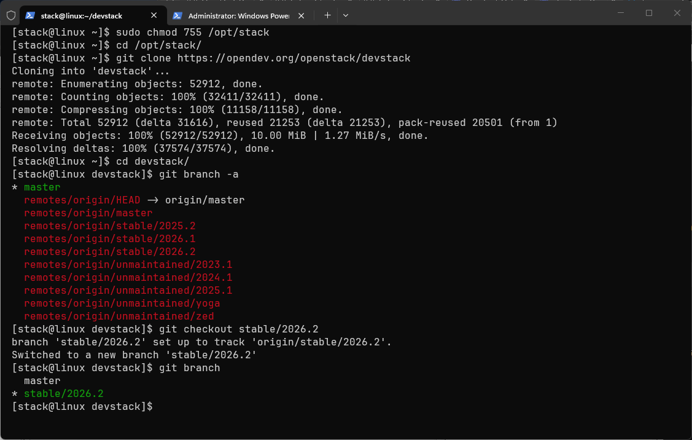

---

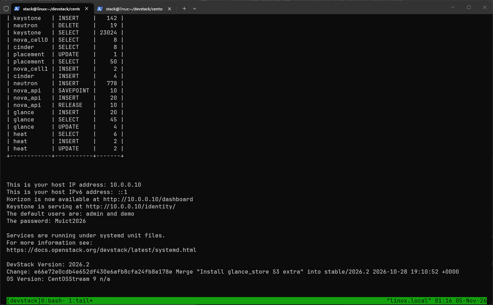

## upgrade pyton เป็น 3.11 centos 9 stream

```
# 1. ติดตั้ง Python 3.11 และ pip
sudo dnf install -y python3.11 python3.11-devel python3.11-pip

# 2. ตรวจสอบ
python3.11 --version
python3.11 -m pip --version

export PYTHON3_VERSION=3.11

# 3. กำหนดค่าบังคับใน local.conf
# เพิ่มในส่วน [[local|localrc]]
PYTHON3_VERSION=3.11
```

```
python3.11 -V

pip3.11 -V
```

## 
``
## Step 3: กำหนดค่า DevStack

สร้างไฟล์ `local.conf` โดยใช้ค่าที่เหมาะสมกับเครือข่าย 3 ตัวบน Hyper-V:
(ให้ copy code ข้างล่างไป วางใน Terminal) โครงสร้างนี้เรียกว่า [bash heredoc](https://linuxize.com/post/bash-heredoc/) ทำให้เราสามารถ copy เนื้อหาไป สร้าง file ได้ โดยตรง

```bash
cat > local.conf << 'EOF'
[[local|localrc]]
ADMIN_PASSWORD=Muict2024
DATABASE_PASSWORD=$ADMIN_PASSWORD
RABBIT_PASSWORD=$ADMIN_PASSWORD
SERVICE_PASSWORD=$ADMIN_PASSWORD

SERVICE_IP_VERSION=4
IP_VERSION=4
PYTHON3_VERSION=3.11

# IP ของ Management Interface (eth1) — ใช้กับ Horizon / API
HOST_IP=10.0.0.10

# Enable Service
enable_service rabbit mysql key
enable_service n-api n-cpu n-cond n-sch n-novnc n-cauth
enable_service g-api g-reg
enable_service cinder c-sch c-api c-vol
enable_service neutron q-svc q-ovn-metadata-agent
enable_service s-proxy s-object s-container s-account
enable_service placement-api

# เปิดใช้งานปลั๊กอิน Heat
enable_plugin heat https://opendev.org/openstack/heat

# Cinder
VOLUME_GROUP_NAME="stack-volumes"
VOLUME_NAME_PREFIX="volume-"
VOLUME_BACKING_FILE_SIZE=24G

# ===== Neutron Networking สำหรับ Hyper-V 3 Adapters =====
# External Network สำหรับ Floating IPs
FLOATING_RANGE=192.168.56.0/24
PUBLIC_BRIDGE=br-ex
Q_FLOATING_ALLOCATION_POOL=start=192.168.56.100,end=192.168.56.200

# Physical interface สำหรับ br-ex bridge (eth2)
FLAT_INTERFACE=eth2
PUBLIC_INTERFACE=eth2

# Private Network สำหรับ VM ภายใน
FIXED_RANGE=10.10.10.0/24
FIXED_NETWORK_SIZE=256

# ปิดบริการที่ไม่จำเป็นสำหรับ Lab
disable_service tempest

# การบันทึก Log
LOGFILE=/opt/stack/logs/stack.sh.log
LOGDAYS=2
LOG_COLOR=True
VERBOSE=True

# Download Fedora image
IMAGE_URL_SITE="https://download.fedoraproject.org"
IMAGE_URL_PATH="/pub/fedora/linux/releases/45/Cloud/x86_64/images/"
IMAGE_URL_FILE="Fedora-Cloud-Base-Generic-45-1.4.x86_64.qcow2"
IMAGE_URLS+=","$IMAGE_URL_SITE$IMAGE_URL_PATH$IMAGE_URL_FILE
EOF

```

```
# Verify 
cat local.conf
```
!!! config ":gear: สำคัญ: ปรับ HOST_IP"
    ปรับ `HOST_IP` ให้ตรงกับ IP ของ Management Interface (eth1) บน VM ของคุณ
    ใช้คำสั่ง `ip addr show eth1` เพื่อตรวจสอบ

!!! config ":lock: รหัสผ่าน"
    เปลี่ยน `ADMIN_PASSWORD` ให้ปลอดภัย ในตัวอย่างใช้ `Muict2024` ค่าอื่น ๆ จะใช้รหัสเดียวกันเพื่อความสะดวกใน Lab

---

##  Devstack เรียกใช้งาน local.conf ได้อย่างไร ?

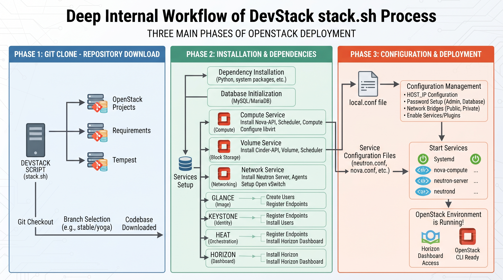

DevStack เรียกใช้ `local.conf` ผ่านกลไก **"source (โหลด)"** เมื่อเริ่มต้น `stack.sh` ไฟล์นี้ไม่ใช่ไฟล์กำหนดค่าที่โปรแกรมแยกวิเคราะห์แบบทั่วไป แต่เป็น **สคริปต์เชลล์ที่ถูก source เข้ามา** ดังนั้นตัวแปรทั้งหมดที่คุณเขียนในนั้นจะถูกนำไปใช้เป็นตัวแปรสภาพแวดล้อมของสคริปต์ทันที และใช้เพื่อ override ค่าเริ่มต้นใน DevStack

### 🔄 ลำดับการโหลดและตำแหน่งไฟล์

1.  **ตำแหน่งไฟล์**: ไฟล์ `local.conf` จะต้องวางไว้ใน**ไดเรกทอรีรากของ DevStack** (เช่น `~/devstack/local.conf`) จึงจะสามารถเรียกใช้ได้อย่างถูกต้อง
2.  **จุดเข้าโหลด**: เมื่อคุณรัน `./stack.sh` สคริปต์จะโหลด `stackrc` ก่อน ในขั้นตอนนี้ `stackrc` จะทำการ **source** ไฟล์ `local.conf` โดยอัตโนมัติ
3.  **กลไกการ override**: เนื่องจากเป็นการโหลดแบบ source ตัวแปรที่คุณกำหนดใน `local.conf` (เช่น `HOST_IP`, `ADMIN_PASSWORD`) จะ**แทนที่**ค่าเริ่มต้นที่กำหนดไว้ล่วงหน้าใน `stackrc` หรือสคริปต์อื่นๆ โดยตรง

### 📝 กฎไวยากรณ์สำคัญ

เนื่องจากมันถูกประมวลผลเป็นสคริปต์เชลล์ จึงต้องปฏิบัติตามไวยากรณ์ของเชลล์อย่างเคร่งครัด:
*   **ห้ามมีช่องว่าง**: เครื่องหมายเท่ากับ `=` ทั้งสองด้าน**ห้ามมีช่องว่าง** ตัวอย่างเช่น ต้องเขียนเป็น `HOST_IP=10.20.30.11` ไม่สามารถเขียนเป็น `HOST_IP = 10.20.30.11`
*   **หัวข้อพิเศษ**: `[[local|localrc]]` ที่จุดเริ่มต้นไฟล์คือส่วนหัวพิเศษที่บอกให้ DevStack รู้ว่าส่วนนี้คือการกำหนดค่าแบบ local ที่ต้องโหลดก่อน จากนั้นเนื้อหาที่ตามมาจะถูกดำเนินการเหมือนสคริปต์เชลล์

พูดง่ายๆ คือ `stack.sh` เมื่อเริ่มต้นจะ "อ่าน" ไฟล์ `local.conf` ราวกับกำลังรันสคริปต์ เพื่อให้การกำหนดค่าของคุณมีผลตั้งแต่เริ่มต้น

## Step 4: รันคำสั่งติดตั้ง DevStack
- ใช้ Tmux มาช่วย ในการ monitor
```bash
sudo dnf install tmux
tmux new -s devstack

# เปิดใช้งานรีพอสิทอรี messaging ของ Ubuntu 24.04
sudo dnf install -y centos-release-rabbitmq-38
# หรือลองติดตั้งโดยตรง
sudo dnf install -y rabbitmq-server
```

## Step คำสั่งที่ใช้
```
cd ~/devstack

# 1. หยุด service ที่ค้าง (ถ้ามี)
./unstack.sh 2>/dev/null

# 2. ล้าง state
./clean.sh 2>/dev/null

# 3. ล้าง pip cache (กันปัญหา dependency ค้างจากรอบก่อน)
sudo -H python3.11 -m pip cache purge

# 4. รัน stack ใหม่
./stack.sh 2>&1 | tee /tmp/stack-install.log
```


การติดตั้งจะใช้เวลา **30–90 นาที** ขึ้นอยู่กับความเร็วอินเทอร์เน็ตและฮาร์ดแวร์  โดย Stack.sh จะเริ่มจากติดตั้ง Repository ที่จำเป็นต้องใช้ ให้เราเอง อัตโนมัต และ จำทำการติดตั้ง service

หากสำเร็จ จะแสดงข้อความคล้ายกับนี้:

```
=========================
DevStack Component Timing
=========================
Total runtime: 2847 seconds
...
This is your host IP address: 10.20.30.11
This is your host IPv6 address: ::1
Horizon is now available at http://10.20.30.11/dashboard
Keystone is serving at http://10.20.30.11/identity/
The default users are: admin and demo
The password: Muict@2024
```

## กรณีที่รันซ้ำได้ปลอดภัย

DevStack ออกแบบมาให้ทำงานซ้ำได้ (idempotent ในหลายขั้นตอน) เช่น ถ้า git clone มีอยู่แล้วจะข้าม, database มีอยู่แล้วจะไม่สร้างใหม่

```
# Edit local.conf
vim local.conf

# Run 
./unstack.sh
./stack.sh
```

### 🧹 คำสั่งที่ควรรู้

| คำสั่ง | ผลลัพธ์ | ใช้เมื่อ |
|---|---|---|
| `./unstack.sh` | หยุด services, ลบ screen, ล้าง network บางส่วน  | แก้ config แล้วอยากเริ่มใหม่ |
| `./unstack.sh --all` | เหมือนข้างบน + ล้าง volume/data ด้วย | อยากเริ่มสะอาดกว่า |
| `./clean.sh` | ลบ database, state, volume ทั้งหมด | stack พังหนัก แก้ไม่หาย |
| `./stack.sh` | ติดตั้ง/เริ่ม services | ติดตั้งครั้งแรก หรือหลัง unstack/clean |

---
หน้าที่ สคริปต์หลักทั้ง 3 ตัวใน DevStack มีหน้าที่และการทำงานที่แตกต่างกันดังนี้ครับ:

* **`unstack.sh`**: ใช้สำหรับ **หยุด (Stop)** การทำงานของเซอร์วิสและโพรเซสทั้งหมดของ OpenStack และ DevStack ที่กำลังรันอยู่ แต่ยังคงเก็บข้อมูลตั้งค่า, ฐานข้อมูล และไฟล์ต่างๆ ไว้เหมือนเดิม
* **`stack.sh`**: ใช้สำหรับ **ติดตั้งและเริ่มการทำงาน (Start/Deploy)** เซอร์วิสทั้งหมดของ OpenStack ตามไฟล์คอนฟิก `local.conf` ที่คุณกำหนดไว้
* **`clean.sh`**: ใช้สำหรับ **ลบและล้างข้อมูลทั้งหมด (Clean/Purge)** ที่ DevStack เคยสร้างขึ้นมา เช่น ฐานข้อมูลทั้งหมด, โฟลเดอร์ข้อมูลใน `/opt/stack`, บริดจ์เน็ตเวิร์ก (เช่น `br-ex`) และอิมเมจ เพื่อเคลียร์ระบบให้กลับมาเหมือนก่อนติดตั้งใหม่ตั้งแต่ต้น (เสมือนรีเซ็ตระบบให้สะอาดหมดจด)

---

### หากมีการเปิด ปิดเครื่อง
- สั่งรันสคริปต์เดิมซ้ำเพื่อปลุกเซอร์วิสและเน็ตเวิร์กทั้งหมดของ OpenStack ขึ้นมาใหม่:

```
cd /opt/stack/devstack
# ก่อนปิดเครื่อง
./unstack.sh

# เมื่อเปิดเครื่อง
./stack.sh
```
- Verification: รอจนกระทั่งสคริปต์ทำงานเสร็จสิ้น จะแสดงข้อความสรุปพร้อมลิงก์เข้าสู่หน้าเว็บ Horizon Dashboard และข้อมูล Endpoint

!!! info "ข้อควรระวังเรื่อง IP Address"
    หากเครื่องคอมพิวเตอร์ของคุณเชื่อมต่อผ่าน DHCP และได้รับ IP Address ใหม่ (ซึ่งจะทำให้ค่า HOST_IP ที่เคยตั้งไว้ใน local.conf ไม่ตรงกับ IP ปัจจุบัน) การรัน ./stack.sh อาจเกิดข้อผิดพลาดได้ แนะนำให้ตรวจสอบ IP ของเครื่องด้วยคำสั่ง ip a ก่อนทุกครั้งว่ายังคงตรงกับค่า HOST_IP ที่ตั้งไว้หรือไม่

## Step 5: ตรวจสอบการติดตั้ง

### โหลด Credentials

```bash
cd /opt/stack/devstack
source openrc admin 
```

### ตรวจสอบบริการต่าง ๆ

- Python API & SDK (วิธีที่นักพัฒนาเรียกใช้งาน OpenStack) ในการเขียนโปรแกรมคุยกับ OpenStack หรือแกะโค้ดส่วนที่เป็น Client SDK นักพัฒนาจะใช้เครื่องมือหลัก python-openstackclient  (Openstack CLI)  ทำให้สามารถใช้ คำสั่ง openstack ต่างๆ ได้

```bash
# รายการบริการ Compute
openstack compute service list

# รายการ Network Agent
openstack network agent list

# รายการ VM (ควรว่าง)
openstack server list

# รายการรูปแบบ (Flavors)
openstack flavor list

# รายการรูป VM (Images)
openstack image list
```

### ตรวจสอบ Horizon Dashboard

เปิดเว็บเบราว์เซอร์บนเครื่อง Host (Windows) และเข้าไปที่:

```
http://10.20.30.11/dashboard
```

| ช่อง | ค่า |
|------|-----|
| Domain | `default` |
| User Name | `admin` |
| Password | `Muict@2024` (หรือ ADMIN_PASSWORD ที่ตั้งไว้) |

---

## Step 6: สร้าง VM ตัวแรกผ่าน CLI

```bash
# โหลด credentials ของ demo user
source /opt/stack/devstack/openrc demo demo

# สร้าง Keypair
ssh-keygen -t rsa -f ~/.ssh/devstack_key -N ""
openstack keypair create --public-key ~/.ssh/devstack_key.pub devstack_key

# เปิด Security Group สำหรับ SSH
openstack security group rule create --protocol tcp --dst-port 22 \
  --remote-ip 0.0.0.0/0 default

# สร้าง VM
openstack server create \
  --image cirros-0.6.2-x86_64-disk \
  --flavor m1.tiny \
  --network private \
  --key-name devstack_key \
  --security-group default \
  --wait \
  vm-01

# ตรวจสอบสถานะ
openstack server list
```

---

## ปัญหาที่พบบ่อย

| ปัญหา | วิธีแก้ไข |
|-------|-----------|
| `stack.sh` ล้มเหลว มีข้อผิดพลาดเกี่ยวกับ apt | CentOS ใช้ `dnf` ไม่ใช่ `apt` — DevStack รองรับอัตโนมัติ แต่ตรวจสอบว่ามีอินเทอร์เน็ต |
| หน่วยความจำไม่พอ OOM | เพิ่ม RAM VM เป็น 12-16 GB หรือเพิ่ม Swap |
| เครือข่ายไม่สามารถเชื่อมต่อได้ | ตรวจสอบ `HOST_IP` และ `FLAT_INTERFACE` ใน local.conf |
| ติดตั้งไม่สำเร็จ | รัน `./unstack.sh && ./stack.sh` อีกครั้ง |
| Neutron agent รายงาน XXX | ตรวจสอบว่า eth2 (FLAT_INTERFACE) อยู่ใน state UP |
| ไม่สามารถเข้า Horizon ได้ | ตรวจสอบ firewall — `sudo systemctl status firewalld` |

---

### การเปลี่ยนผ่านสู่ OVN (Open Virtual Network):
- Exclude q-get,q-l3

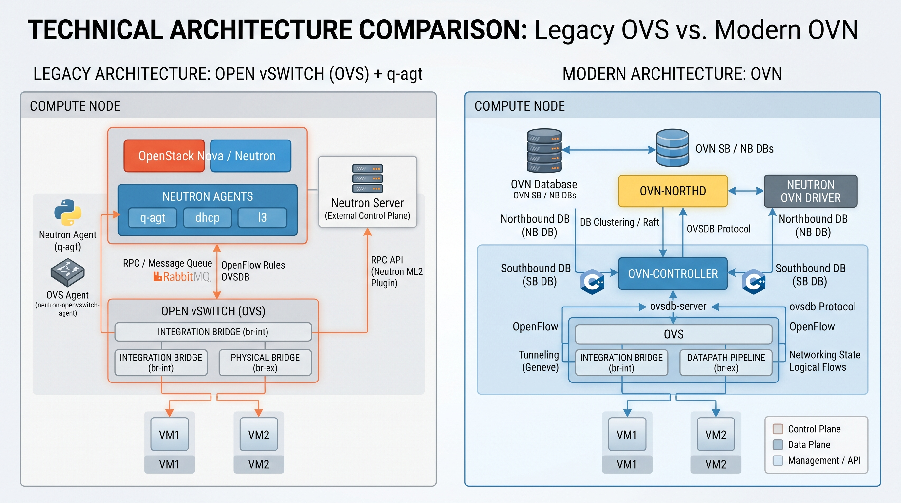

- ในเวอร์ชันปัจจุบันของ DevStack และ Neutron ค่าเริ่มต้นของการทำระบบเน็ตเวิร์กได้เปลี่ยนมาใช้ OVN เป็น Backend หลักแทนสถาปัตยกรรม Open vSwitch (OVS) แบบดั้งเดิม

- OVN จะควบคุมการทำ Virtual Networking ผ่าน ovn-controller และ ovn-northd ในตัวอยู่แล้ว
- เซอร์วิส q-agt (neutron-openvswitch-agent) ทำหน้าที่ควบคุม OVS แบบเก่า ซึ่งการทำงานจะชนและทับซ้อนกับระบบ OVN ที่ถูกเปิดใช้งานขึ้นมาพร้อมกัน
- เมื่อเราปิดการใช้งาน q-l3 (Neutron L3 Agent) ในสถาปัตยกรรม OVN งานด้าน Layer 3 (เช่น การทำ Routing, Floating IP, และ Distributed Virtual Routing - DVR) ทั้งหมดจะถูกโอนย้ายไปให้ OVN (Open Virtual Network) เป็นผู้จัดการโดยอัตโนมัติที่ระดับล่าง (Kernel/Datapath) ผ่าน ovn-controller แทนครับ

- คุณไม่จำเป็นต้องสร้าง L3 Agent แบบดั้งเดิมขึ้นมาใหม่ เนื่องจากระบบ OVN ได้ฝังฟังก์ชันการทำงานเหล่านี้ไว้ในสถาปัตยกรรมภายในเรียบร้อยแล้ว

- ตรวจสอบว่าเซอร์วิสที่เกี่ยวข้องกับ OVN ทำงานครบถ้วนหรือไม่ด้วยคำสั่ง:
```
sudo systemctl status devstack@q-ovn-metadata-agent devstack@ovn-controller
```

### OVN management plan และ Control plan

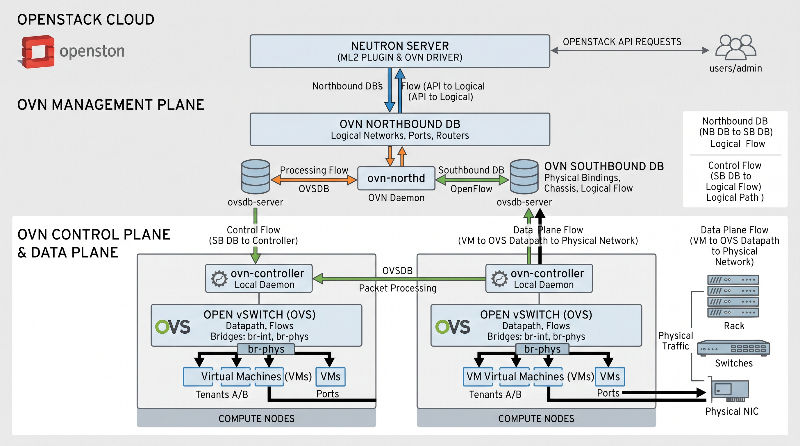

สรุปสถาปัตยกรรมของ **OVN (Open Virtual Network)** ในส่วนของ **Management Plane** และ **Control Plane** เพื่อให้เข้าใจบทบาทและการทำงานร่วมกับ OpenStack ได้อย่างชัดเจนครับ:

---

### 1. OVN Management Plane (ระดับการจัดการและกำหนดนโยบาย)

Management Plane ทำหน้าที่รับคำสั่งจากผู้ดูแลระบบหรือ OpenStack API แล้วแปลงให้เป็นโครงสร้างข้อมูลเน็ตเวิร์กเชิงตรรกะ (Logical Networks)

* **OpenStack Neutron (ML2/OVN Driver):** ทำหน้าที่รับคำสั่ง REST API จากผู้ใช้ (เช่น สั่งสร้าง Network, Router, Subnet) แล้วบันทึกลงไปในฐานข้อมูลกลาง
* **OVN Northbound DB (NB DB):** ฐานข้อมูลที่เก็บข้อมูลเน็ตเวิร์กในมุมมองเชิงตรรกะ (Logical Switch, Logical Router, Port, ACL) โดยไม่สนใจว่าโครงสร้างฮาร์ดแวร์เบื้องหลังจะเป็นอย่างไร
* **`ovn-northd` (Daemon ตัวกลาง):** ทำหน้าที่เป็นสะพานเชื่อมและตัวแปลภาษา คอยอ่านข้อมูลจาก Northbound DB มาประมวลผล แล้วแปลงย่อส่วนลงไปเก็บบันทึกไว้ใน Southbound DB เพื่อให้ฝั่ง Control Plane นำไปใช้งานต่อ

---

### 2. OVN Control Plane (ระดับควบคุมและสั่งการ)

Control Plane ทำหน้าที่กระจายและแปลนโยบายเชิงตรรกะให้กลายเป็นกฎการส่งข้อมูลจริงบนโหนดประมวลผล (Compute Nodes) แต่ละเครื่อง

* **OVN Southbound DB (SB DB):** ฐานข้อมูลศูนย์กลางที่เก็บสถานะทางกายภาพทั้งหมด เช่น รายชื่อเครื่อง Compute Node (Chassis) ที่มีอยู่, การผูกพอร์ตของ VM เข้ากับโหนดไหน, และ Logical Flows ที่ถูกแปลมาแล้ว
* **`ovn-controller` (Daemon ประจำโหนด):**
* เป็นเซอร์วิสที่จะรันอยู่บนทุก Compute Node คอยเฝ้าฟังความเปลี่ยนแปลงจาก Southbound DB
* ทำหน้าที่แปลง Logical Flows ให้กลายเป็นกฎ OpenFlow และสั่งการไปยัง **Open vSwitch (OVS)** บนเครื่องนั้นๆ ให้จัดการเส้นทางแพ็กเกจข้อมูล


---

### สรุปภาพรวมการทำงาน (Flow)

1. **User / OpenStack API** สั่งสร้างเครือข่ายผ่าน Neutron
2. ข้อมูลถูกบันทึกที่ **Northbound DB**
3. **`ovn-northd`** แปลงข้อมูลแล้วส่งต่อไปยัง **Southbound DB**
4. **`ovn-controller`** บนแต่ละ Compute Node ดึงข้อมูลจาก Southbound DB ไปสั่งงาน **OVS** ให้เปิดช่องทางรับส่งแพ็กเกจข้อมูลระหว่าง Virtual Machines (VMs) ได้อย่างแม่นยำและรวดเร็วโดยไม่ต้องพึ่งพา Agent แบบเดิม (`q-agt`, `q-l3`) อีกต่อไป

---

## การล้างข้อมูลและเริ่มใหม่

```bash
cd /opt/stack/devstack
./unstack.sh 2>/dev/null
./clean.sh 2>/dev/null
./stack.sh 2>&1 | tee /tmp/stack-install.log
```

หากต้องการเริ่มต้นใหม่ทั้งหมด แนะนำให้ **Restore Snapshot** จาก Hyper-V Manager แทน:

```
Hyper-V Manager → คลิกขวาที่ VM → Restore → เลือก "Clean Ubuntu 24.04"
```

---

## สรุปการตั้งค่าเครือข่าย

| อินเทอร์เฟซ | Virtual Switch | IP | บทบาทใน OpenStack |
|-----------|---------------|-----|-------------------|
| eth0 | DefaultSwitch | DHCP | อินเทอร์เน็ต/ดาวน์โหลด |
| eth1 | Internal-Mgmt | 10.20.30.11 | Horizon/API, HOST_IP |
| eth2 | Internal-BrEx | 192.168.56.11 | br-ex, Floating IPs |

---

สคริปต์ของ DevStack จะสร้างและผูก `br-ex` (External Bridge) เพื่อทำหน้าที่เป็นสะพานเชื่อมระหว่างโครงสร้างเครือข่ายเสมือนของ OpenStack (เช่น VMs) กับโครงสร้างเครือข่ายภายนอก (Physical Network / Internet) ครับ

### ขั้นตอนการทำงานเบื้องหลังของ Script เมื่อสร้าง `br-ex`

1. **สร้าง Open vSwitch Bridge (`br-ex`):**
* สคริปต์จะใช้คำสั่งของ Open vSwitch เพื่อสร้าง Virtual Bridge ขึ้นมาในระบบ ลีนุกซ์ (เช่นเดียวกับการสร้างสวิตช์เสมือน)


2. **เชื่อมต่อ Physical Interface (`eth2`):**
* สคริปต์จะนำอินเทอร์เฟซจริงของเครื่อง (ตามที่คุณกำหนดใน `local.conf` เช่น `FLAT_INTERFACE=eth2`) มาผูกเข้ากับ `br-ex` ทำให้พอร์ตจริงกลายเป็นส่วนหนึ่งของบริดจ์นี้


3. **กำหนด IP และ Routing (จุดที่เกิดปัญหา):**
* ระบบเน็ตเวิร์กของลินุกซ์หรือสคริปต์บางตัว อาจพยายามกำหนด IP Address หรือสร้าง **Default Route ผ่านบริดจ์ `br-ex**` โดยอัตโนมัติ เพื่อให้สมมติว่าทราฟฟิกภายนอกวิ่งผ่านเส้นทางนี้
* **ผลกระทบ:** ทำให้เกตเวย์หลักของเครื่องที่เคยออกอินเทอร์เน็ตผ่าน `eth0` ถูกทับด้วยเกตเวย์ของ `br-ex` ทำให้เครื่องหลุดจากการเชื่อมต่ออินเทอร์เน็ตภายนอก (เหตุผลที่เราต้องใช้คำสั่ง `sudo ip route del default dev br-ex` เพื่อดึงเส้นทางกลับมาที่ `eth0` ครับ)


!!! homework ":clipboard: การบ้าน"
    📋 **รายงานการทดลอง:**

    1. Screenshot หน้า Horizon Dashboard หลังจากเข้าสู่ระบบสำเร็จ
    2. Screenshot รายการ `openstack compute service list`
    3. Screenshot รายการ `openstack network agent list`
    4. Screenshot `openstack server list` แสดง vm-01 กำลังทำงาน
    5. ตอบคำถาม: `HOST_IP` ใน `local.conf` มีหน้าที่อะไร?
    6. ตอบคำถาม: ทำไมต้องมี 2 อินเทอร์เฟซแยกกัน (Mgmt vs External)?

    ส่งผ่าน: [Google Classroom / LMS]


## Note : Listnetwork

```
PS C:\Users\sysadmin> Get-VMSwitch | Select Name, SwitchType, NetAdapterInterfaceDescription

Name              SwitchType NetAdapterInterfaceDescription
----              ---------- ------------------------------
Default Switch      Internal
Internal-Mgmt-Net   Internal
Internal-BrEx-Net   Internal
WSL (Hyper-V f...   Internal
```

## สร้าง  virtual switch ในเครื่อง lab
```
# ============================================
# สร้าง Virtual Switch สำหรับ OpenStack Lab
# รันใน PowerShell แบบ Administrator
# ============================================

# 1. ดูการ์ดเครือข่ายจริงก่อน (จดชื่อไว้)
Get-NetAdapter | Select Name, InterfaceDescription, Status

# 2. สร้างสวิตช์ management (Internal) — สำหรับ eth0, eth1
New-VMSwitch -Name "Internal-Mgmt-Net" -SwitchType Internal

# 3. สร้างสวิตช์ br-ex (Internal) — สำหรับ eth2
New-VMSwitch -Name "Internal-BrEx-Net" -SwitchType Internal

# 4. ตรวจสอบว่าสร้างสำเร็จ
Get-VMSwitch | Select Name, SwitchType
```

## import vm command line

```
# Import VM (แก้ path ตามจริง)
Import-VM -Path "D:\HyperV-Backup\ชื่อVM\Virtual Machines\XXXX.xml" -Copy -GenerateNewId
```

หรือผ่าน Hyper-V Manager:

- คลิก Import Virtual Machine

- เลือกโฟลเดอร์ Export

- เลือก Copy the virtual machine (create a new unique ID)

- เลือกที่เก็บไฟล์

- ตรวจสอบ mapping สวิตช์ (ควรเจอชื่อเดียวกันอัตโนมัติ)


```
# ดูว่า VM ผูกกับสวิตช์ถูกต้องไหม
Get-VMNetworkAdapter -VMName "ชื่อVM" | Select Name, SwitchName
```

```
ขั้นตอนก่อน Import OpenStack VM:

1. เปิด PowerShell (Run as Administrator)

2. รันคำสั่ง:
   New-VMSwitch -Name "Internal-Mgmt-Net" -SwitchType Internal
   New-VMSwitch -Name "Internal-BrEx-Net" -SwitchType Internal

3. ตรวจสอบ:
   Get-VMSwitch | Select Name, SwitchType

4. Import VM ผ่าน Hyper-V Manager
   → เลือก "Copy the virtual machine"
   → mapping สวิตช์จะตรงอัตโนมัติ

5. เปิด VM → ตรวจสอบ network:
   ip a
```

Fix intall Centos 9 Stream
```
# 1. ดูบริบทก่อน
sed -n '30,60p' ~/devstack/lib/rpc_backend

# 2. Comment ทั้ง 2 บรรทัด
sudo sed -i '40s/^/# /' ~/devstack/lib/rpc_backend
sudo sed -i '54s/^/# /' ~/devstack/lib/rpc_backend

# 3. ตรวจสอบ
sed -n '35,60p' ~/devstack/lib/rpc_backend

# 4. ยืนยันว่า RabbitMQ ยังอยู่ (ถ้าถูกลบไปแล้ว ให้ติดตั้งใหม่)
rpm -q rabbitmq-server
# ถ้าไม่มี:
sudo dnf install -y https://github.com/rabbitmq/rabbitmq-server/releases/download/v4.4.0/rabbitmq-server-4.4.0-1.el8.noarch.rpm
sudo systemctl enable --now rabbitmq-server
sleep 10
sudo rabbitmqctl status

# 5. รัน stack.sh
cd ~/devstack
./stack.sh 2>&1 | tee /tmp/stack-install.log
```


```
source openrc admin admin
openstack service list
openstack endpoint list
openstack hypervisor list
```