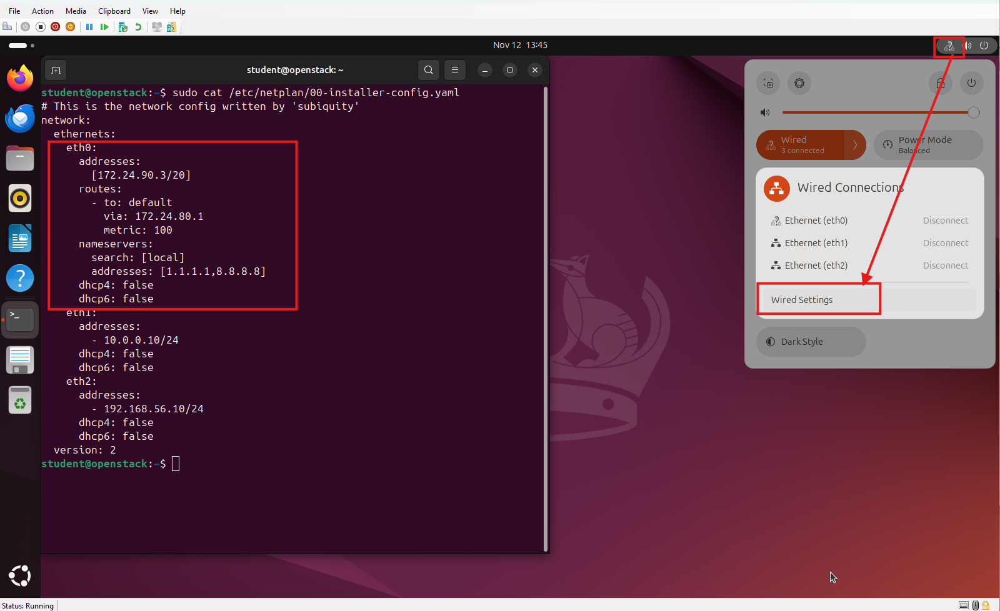
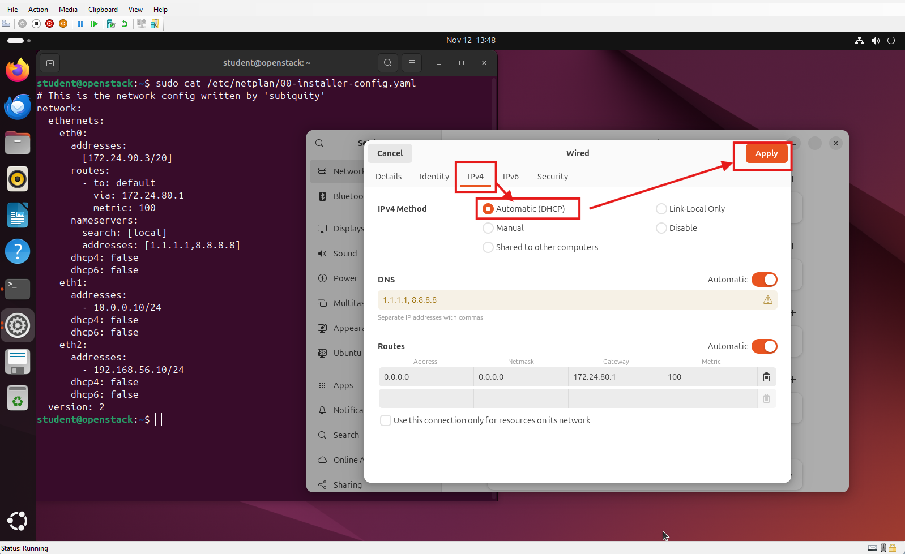
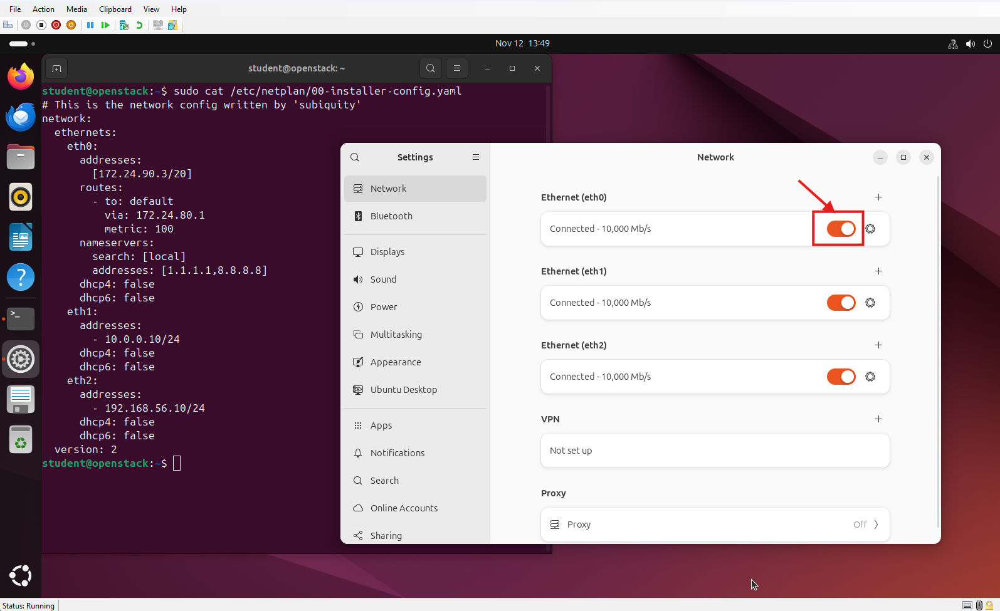
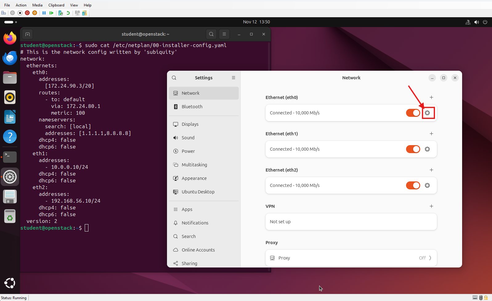
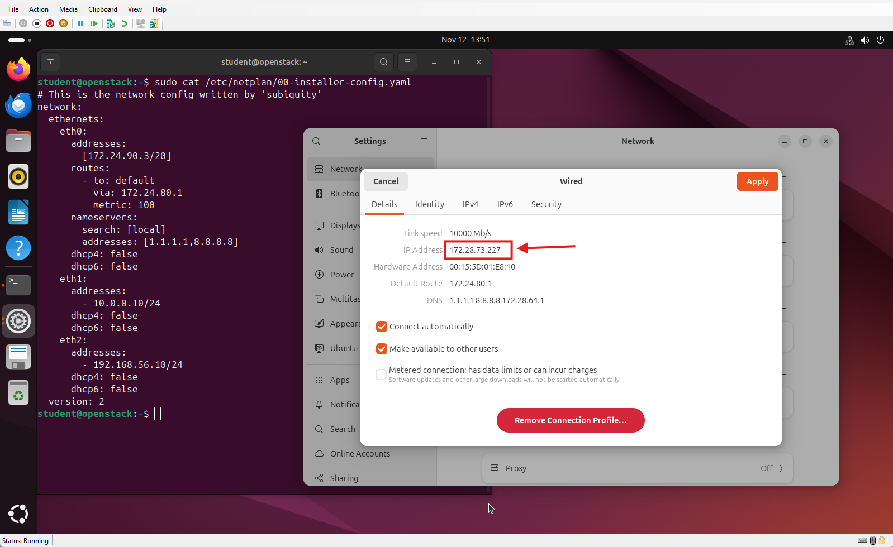
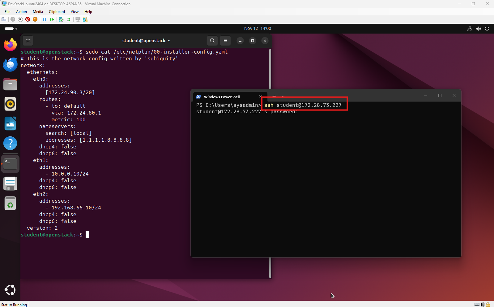
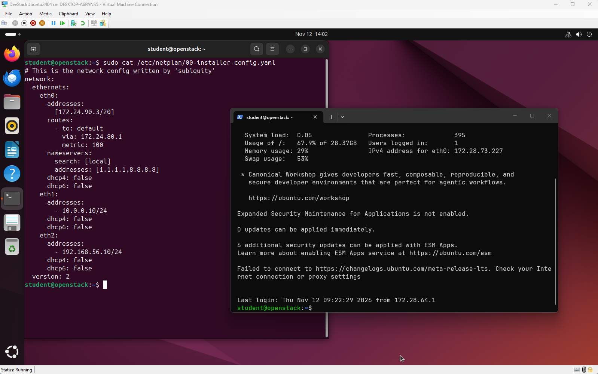

# Import Devstack Ubuntu to HyperV

## วัตถุประสงค์
1. เรียนรู้การ Import VM เข้ามาใน Hyper V
2. สร้าง internal network สำหรับ Devstack
3. ตรวจสอบ network eth0, eth1, eth2
4. ทดสอบการ SSH ยัง VM

## เอกสาร

[เอกสารประกอบ](./Setup_DevStack_kvm.docx)

# การ copy Text จาก host ไปยัง VM linux
- การใช้งาน Web Dash board สามารถใช้งานได้โดยตรง เมื่อ เปิด VM ไม่มีปัญหาอะไร 
- แนะนำให้ SSH ไปยังเครื่อง VM จาก เครื่อง Windows จะสามารถทำได้ง่ายกว่า เมือต้องการใช้ Terminal

# ปัญหาที่ เจอ การ login
- ในบางครั้ง ไม่สามารถ ssh ไปยัง eth0 ของ Server ได้ เนื่องจากมีการ Fix ip ไว้ใน file /etc/netplan/00-installer-config.yaml
    - ให้ทำการเปลี่ยน จาก โหมด Manual Fix ip เป็น โหมด DHCP เลือก ที่มุมขวาบน 

    - กดปุ่ม รูป Gear เป็นการ Setting

    - เลือก tab ipv4 >  Automatic (DHCP) > Apply

    - ปรับเป็น Enable

    - กด ดู Setting

    - จด ip ไว้เพื่อใช้สำหรับ login จาก windows (172.28.73.227)

    - เปิด Windows terminal ,  ssh ไปยัง  ip  user student,  password  muictP@ssw0rd
 
    - ใช้งานได้ได้ตามปรกติ

# คำแนะนำ
- เนื่องจากเป็นการใช้งาน Linux ที่มีคำสั่ง หลายคำสั่ง แต่คำสั่ง เป็นการทำงานต่อเนื่องกัน เป็นลำดับขั้นตอน ดังนี้น ในระหว่างการทำ Lab ควรหากระดาษ หรือ note ใน ipad เพื่อจัดกลุ่มของคำสั่ง ด้วยความเข้าใจของตนเอง

# อ้างอิง
- การตั้งค่า network ใน  ubuntu [https://ubuntu.com/server/docs/explanation/networking/configuring-networks/](https://ubuntu.com/server/docs/explanation/networking/configuring-networks/)

