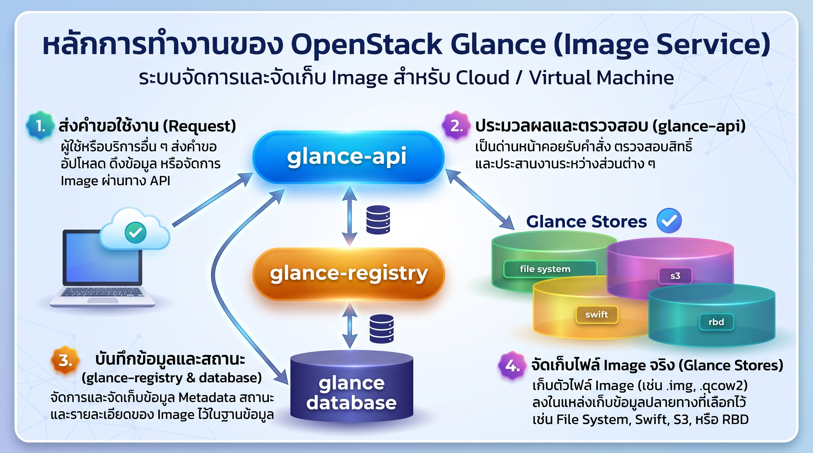
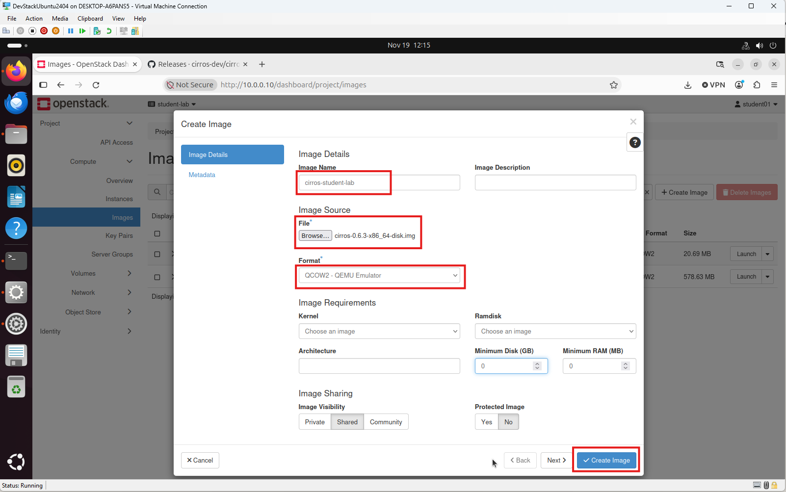

## เสริม คำอธิบาย Glance images option 

หน้าต่าง **Create Image** บน OpenStack Horizon Dashboard (บริการ Glance) มีตัวเลือกแบ่งออกเป็น 4 ส่วนหลัก ดังนี้ครับ

### 1. Image Details (ข้อมูลทั่วไปของ Image)

* **Image Name:** ชื่อของ Image ที่จะแสดงในรายการของ OpenStack (ในภาพตั้งชื่อว่า `cirros-student-lab`) ควรตั้งให้สื่อถึงระบบปฏิบัติการ เวอร์ชัน หรือวัตถุประสงค์การใช้งาน

* **Image Description:** คำอธิบายเพิ่มเติม (ไม่บังคับกรอก) เช่น ระบุรหัสผ่านเริ่มต้น (default user/password) หรือแพ็กเกจที่ติดตั้งไว้ล่วงหน้า

---

### 2. Image Source (แหล่งที่มาและรูปแบบไฟล์)

* **File* (บังคับเลือก):** ปุ่ม Browse สำหรับเลือกไฟล์ Image จากเครื่องคอมพิวเตอร์ของคุณมาอัปโหลดขึ้น Glance Store (ในภาพคือไฟล์ `cirros-0.6.3-x86_64-disk.img`)

* **Format* (บังคับเลือก):** รูปแบบของไฟล์ Disk Image ต้องเลือกให้ตรงกับไฟล์ที่นำเข้า เพื่อให้ Hypervisor (เช่น KVM/QEMU) อ่านข้อมูลได้ถูกต้อง

* **QCOW2 - QEMU Emulator:** รูปแบบมาตรฐานที่นิยมที่สุดบน OpenStack (KVM) รองรับ Thin Provisioning (ใช้พื้นที่ตามจริง) และ Snapshot

* **RAW:** ไฟล์ Disk ดิบที่ไม่มีการบีบอัด ประสิทธิภาพ I/O สูงแต่ใช้พื้นที่เต็มขนาด
* **ISO:** ไฟล์อิมเมจแผ่นติดตั้งระบบปฏิบัติการ (ต้องสร้าง Instance เพื่อติดตั้งลง Volume อีกที)
* **VMDK / VDI / VHD:** ไฟล์ Disk ที่มาจาก VMware, VirtualBox หรือ Hyper-V

---

### 3. Image Requirements (ข้อกำหนดขั้นต่ำของระบบ)

ส่วนนี้ใช้กำหนดเงื่อนไขและทรัพยากรขั้นต่ำเมื่อนำ Image นี้ไปสร้าง Instance (VM) หากไม่ระบุ สามารถปล่อยว่างหรือเป็น `0` ได้

* **Kernel / Ramdisk:** ใช้เลือกไฟล์ AKI (Amazon Kernel Image) และ ARI (Amazon Ramdisk Image) แยกต่างหาก เหมาะสำหรับ Image รุ่นเก่าที่ไม่ได้ฝัง Kernel ไว้ในตัว (สำหรับ QCOW2 สมัยใหม่ไม่ต้องเลือก)

* **Architecture:** ระบุสถาปัตยกรรม CPU ที่ Image นี้รองรับ เช่น `x86_64` หรือ `aarch64` เพื่อช่วย Nova Scheduler จัดสรรลง Compute Node ที่ตรงกัน

* **Minimum Disk (GB):** ขนาดพื้นที่ Disk ขั้นต่ำที่ Flavor ต้องมีจึงจะสร้าง VM จาก Image นี้ได้ (หากตั้งเป็น `0` จะไม่มีการจำกัดขั้นต่ำ)

* **Minimum RAM (MB):** ขนาดหน่วยความจำ (RAM) ขั้นต่ำที่ Flavor ต้องมี (เช่น CirrOS ใช้ RAM น้อย อาจตั้ง `64` หรือ `128` MB แต่ถ้าเป็น Ubuntu Server มักตั้ง `1024` หรือ `2048` MB)

---

### 4. Image Sharing (การแชร์และการป้องกัน)

* **Image Visibility:** กำหนดสิทธิ์การมองเห็นและการเข้าถึง Image

* **Private:** ใช้ได้เฉพาะภายใน Project (Tenant) ปัจจุบันเท่านั้น

* **Shared:** แชร์ให้ Project อื่นที่ระบุเจาะจงเข้าถึงได้ (ต้องเพิ่ม Project ID สมาชิกภายหลัง)

* **Community:** เปิดให้ทุก Project ในระบบ OpenStack สามารถค้นหาและนำไปใช้งานได้ (แต่จะไม่ไปโผล่ในหน้า Public หลักของทุกคนโดยอัตโนมัติ)

* *(หมายเหตุ: ตัวเลือก **Public** จะปรากฏเฉพาะเมื่อล็อกอินด้วยสิทธิ์ Admin เท่านั้น)*

* **Protected Image:** ป้องกันการเผลอลบ Image

* **Yes:** ล็อกไว้ไม่ให้ลบ Image นี้ได้ จนกว่าจะเข้ามาแก้ไขค่านี้กลับเป็น No

* **No:** สามารถกดลบ Image ได้ตามปกติ

---

**แถบด้านซ้าย (Metadata):** หากกดไปที่แท็บ **Metadata** จะสามารถเพิ่ม Key-Value พิเศษให้ Image ได้ เช่น การตั้งค่า `hw_disk_bus=scsi` หรือ `hw_qemu_guest_agent=yes` เพื่อปรับแต่งการทำงานของฮาร์ดแวร์เสมือนบน KVM ครับ

## ชนิด ของ File Format
ตารางสรุปรูปแบบไฟล์ (File Format) ที่ OpenStack Glance รองรับ แบ่งเป็น 2 หมวดหมู่หลัก:

### 1. Disk Formats (รูปแบบดิสก์เสมือน)

| Format | Hypervisor / ระบบที่ใช้งาน | จุดเด่น / ลักษณะสำคัญ |
| --- | --- | --- |
| **qcow2** | KVM / QEMU | ยอดนิยมที่สุด ประหยัดพื้นที่ (Thin Provisioning) ขยายขนาดตามจริง |
| **raw** | ทั่วไป / KVM / Xen | ประสิทธิภาพ I/O สูงสุด ไม่มีการบีบอัด ใช้พื้นที่เต็มขนาด |
| **iso** | ทั่วไป | ไฟล์แผ่นติดตั้ง OS (Read-Only) |
| **vmdk** | VMware | ดิสก์มาตรฐานของ VMware ESXi / Workstation |
| **vhd / vhdx** | Microsoft Hyper-V | ดิสก์ของ Hyper-V และ XenServer (`vhdx` รองรับขนาดใหญ่กว่า) |
| **vdi** | VirtualBox | ดิสก์มาตรฐานของ Oracle VirtualBox |
| **ploop** | Virtuozzo / OpenVZ | ดิสก์สำหรับระบบ OS Containers |
| **ami / aki / ari** | Amazon EC2-compatible | ชุดไฟล์สำหรับระบบเก่าที่แยก Image, Kernel และ Ramdisk ออกจากกัน |

---

### 2. Container Formats (รูปแบบซองห่อหุ้ม / Metadata)

| Format | ความหมายและการใช้งาน |
| --- | --- |
| **bare** | **นิยมที่สุด** เป็นไฟล์ดิสก์เพียว ๆ ไม่มีซองห่อหุ้มหรือ Metadata ครอบ (ใช้คู่กับ `qcow2` / `raw`) |
| **ovf / ova** | มาตรฐานแพ็กเกจ VM พร้อมไฟล์ตั้งค่าฮาร์ดแวร์ (`ova` คือรวมเป็นไฟล์ `.tar` เดียว) |
| **docker** | ไฟล์ `.tar` ของระบบไฟล์ Docker Container |
| **compressed** | ไฟล์ที่ผ่านการบีบอัดเพื่อลดขนาดและเวลาส่งข้อมูล |
| **ami / aki / ari** | คอนเทนเนอร์เฉพาะของฝั่ง Amazon EC2 |

> **สรุปการใช้งานจริง:** บน OpenStack (KVM) ทั่วไป จะเลือกคู่มาตรฐานคือ Disk Format = **`qcow2`** และ Container Format = **`bare`** ครับ
## อ้างอิง
- [Redhat glance Document](https://docs.redhat.com/en/documentation/red_hat_openstack_platform/17.1/html/creating_and_managing_images/assembly_image-service_osp) 