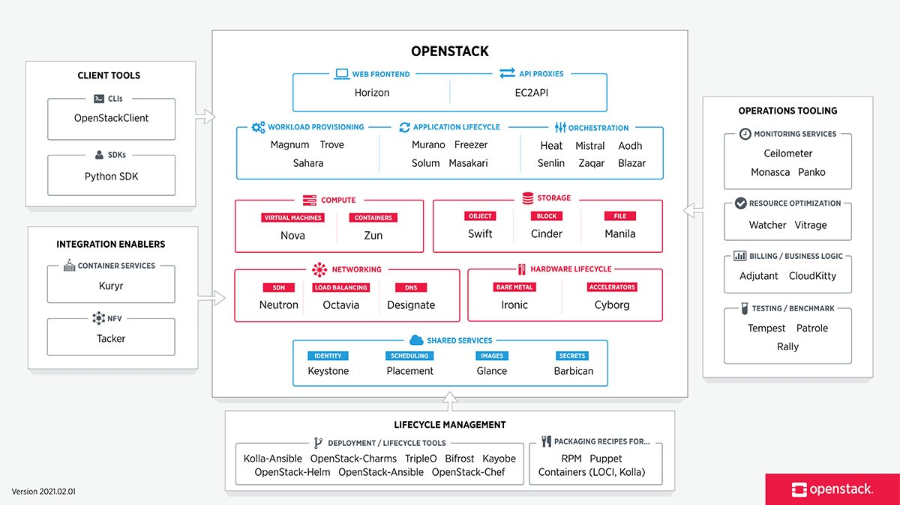
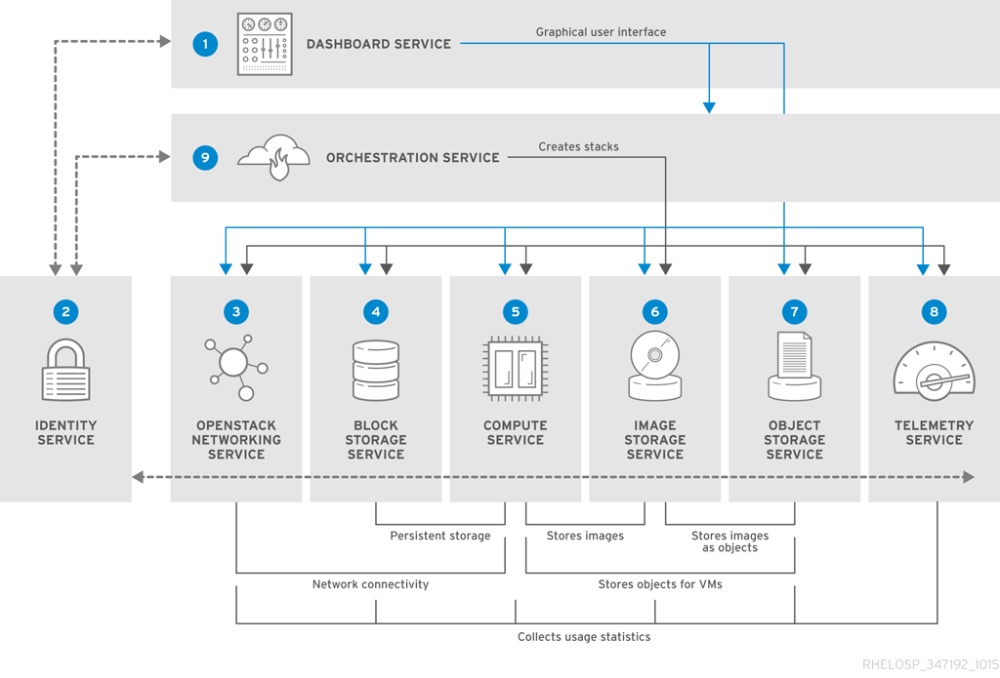
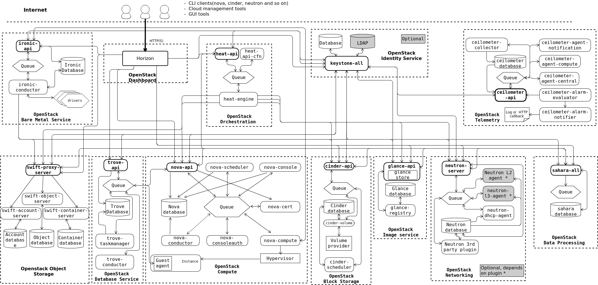

# การบรรยายที่ 1: บทนำสู่ Cloud Computing และ OpenStack

## วัตถุประสงค์การเรียนรู้

- เข้าใจรูปแบบบริการและรูปแบบการติดตั้งของ Cloud Computing
- รู้จักประวัติและระบบนิเวศของ OpenStack
- ระบุบริการหลักของ OpenStack และบทบาทของแต่ละบริการ

---

## Cloud Computing คืออะไร?

Cloud Computing คือการส่งมอบทรัพยากรไอทีตามความต้องการผ่านอินเทอร์เน็ต โดยมีการคิดค่าบริการแบบ Pay-as-you-go

### รูปแบบบริการ (Service Models)

| รูปแบบ | คำอธิบาย | ตัวอย่าง |
|-------|-------------|---------|
| **IaaS** | Infrastructure as a Service — เช่า VM, Storage, Network | OpenStack, AWS EC2 |
| **PaaS** | Platform as a Service — Deploy แอปโดยไม่จัดการ Infrastructure | Heroku, OpenShift |
| **SaaS** | Software as a Service — ใช้แอปผ่านเว็บ | Gmail, Salesforce |

### รูปแบบการติดตั้ง (Deployment Models)

- **Public Cloud** — Infrastructure แชร์กันใช้ (AWS, Azure, GCP)
- **Private Cloud** — Infrastructure สำหรับองค์กรเดียว
- **Hybrid Cloud** — ผสมผสาน Public และ Private
- **Community Cloud** — แชร์ระหว่างองค์กรที่มีเป้าหมายร่วมกัน

---

## ภาพรวม OpenStack

!!! quote "พันธกิจของ OpenStack"
    สร้างแพลตฟอร์ม Cloud Computing แบบ Open Source ที่เป็นที่นิยมใช้ทั้งในภาครัฐและเอกชน โดยไม่คำนึงถึงขนาด

### ประวัติ

- **2010** — โครงการร่วมระหว่าง NASA และ Rackspace
- **2012** — ก่อตั้ง OpenStack Foundation
- **2023** — OpenInfra Foundation ควบคุมโครงการ
- **ล่าสุด** 
    - Epoxy (2025.1) – Apr 2025
    - Flamingo (2025.2) – Oct 2025
    - Gazpacho (2026.1) – Apr 2026
    - Hibiscus (2026.2) – Sep 2026
    - Indri (2027.1) – Mar 2027 (estimated)

### ทำไมต้องใช้ OpenStack?

✅ Open Source — ไม่ผูกขาด Vendor  
✅ Ecosystem บริการกว้างขวาง  
✅ ใช้งานในหลายพันองค์กรทั่วโลก  
✅ Community สนับสนุนเข้มแข็ง  
✅ API รองรับความเข้ากันได้กับ AWS (ในบริการหลายตัว)

---

## ภาพรวมบริการหลัก

| บริการ | ชื่อโค้ด | หน้าที่ |
|---------|----------|---------|
| Identity | **Keystone** | ยืนยันตัวตนและสิทธิ์ |
| Compute | **Nova** | จัดเตรียม Virtual Machine |
| Networking | **Neutron** | บริการเชื่อมต่อเครือข่าย |
| Image | **Glance** | จัดเก็บและจัดการรูป VM |
| Block Storage | **Cinder** | พื้นที่จัดเก็บ Block แบบถาวร |
| Object Storage | **Swift** | ระบบจัดเก็บ Object แบบขยายได้ |
| Dashboard | **Horizon** | หน้า Web UI |
| Orchestration | **Heat** | จัดสรรทรัพยากรด้วย Template |
| Telemetry | **Ceilometer** | เก็บข้อมูล Meter และ Monitoring |


---

## ภาพรวมสถาปัตยกรรม

```
┌─────────────────────────────────────────────────────────┐
│                    Horizon (Web UI)                      │
├─────────────────────────────────────────────────────────┤
│  OpenStack REST APIs  │  Python SDKs  │  CLI Clients    │
├─────────────────────────────────────────────────────────┤
│  Nova  │  Neutron  │  Cinder  │  Glance  │  Swift      │
├─────────────────────────────────────────────────────────┤
│  Message Queue (RabbitMQ)  │  Database (MariaDB)        │
├─────────────────────────────────────────────────────────┤
│  Hypervisor (KVM/QEMU)  │  Linux Bridge / OVS           │
└─────────────────────────────────────────────────────────┘
```


---
## Logical Architecture



---

**OpenStack** เป็นระบบปฏิบัติการคลาวด์โอเพนซอร์ส (Open-source Cloud Operating System) ขนาดใหญ่ ที่รวบรวมบริการต่างๆ (Services) เข้ามาทำงานร่วมกันเพื่อสร้างและบริหารจัดการ Infrastructure as a Service (IaaS) ทั้งระบบ Compute, Storage และ Networking ผ่านแดชบอร์ดหรือ API

สำหรับสถาปัตยกรรมของ OpenStack (OpenStack Architecture) ได้รับการออกแบบมาให้เป็นแบบ **Modular (แยกตามหน้าที่)** และ **Scale-out (ขยายออกด้านข้างได้ง่าย)** โดยประกอบด้วย Core Services หลักๆ และสถาปัตยกรรมภาพรวมดังนี้ครับ

---

### 1. สถาปัตยกรรมภาพรวม (Conceptual Architecture)

ในทางปฏิบัติ โหนด (Node) ใน OpenStack จะถูกแบ่งหน้าที่ออกเป็นหลักๆ ดังนี้:

* **Controller Node:** สมองกลของระบบ ทำหน้าที่รัน API, Authentication (Keystone), Dashboard (Horizon), และ Orchestration ต่างๆ รวมถึง Database (MariaDB) และ Message Queue (RabbitMQ)
* **Compute Node (Hypervisor):** โหนดที่ใช้รัน Virtual Machines (VMs) จริงๆ โดยมักใช้ KVM (Kernel-based Virtual Machine) หรือ QEMU
* **Network Node (Neutron):** โหนดที่จัดการระบบเครือข่าย เורเร้าเตอร์ (Virtual Routers), DHCP, และ Floating IPs (สามารถรวมกับ Controller หรือแยกเดี่ยวก็ได้ขึ้นอยู่กับการออกแบบ)
* **Storage Nodes:**
* **Block Storage Node (Cinder):** จัดเตรียมพื้นที่เก็บข้อมูลแบบ Block สำหรับต่อพ่วงกับ VM (คล้าย Hard Disk)
* **Object Storage Node (Swift):** จัดเก็บข้อมูลแบบไม่มีโครงสร้าง เช่น ไฟล์, รูปภาพ, หรือ Backup (คล้าย S3)


---

### 2. Core Services หลักใน OpenStack Architecture

การทำงานของ OpenStack จะอาศัยบริการเหล่านี้สื่อสารกันผ่าน REST API และส่งข้อความหากันผ่าน Message Broker (RabbitMQ):

1. **Dashboard (Horizon):**
* *หน้าที่:* เว็บ UI สำหรับให้ผู้ใช้ (User) และผู้ดูแลระบบ (Admin) เข้ามาจัดการทรัพยากร


2. **Compute (Nova):**
* *หน้าที่:* หัวใจหลักในการสร้างและจัดการวงจรชีวิตของ Virtual Machine (VM Instances) ควบคุมการเปิด-ปิด, Migration และเชื่อมต่อกับ Hypervisor


3. **Networking (Neutron):**
* *หน้าที่:* บริการจัดการระบบเครือข่ายเสมือน (Software-Defined Networking - SDN) รองรับการสร้าง VLAN, VXLAN, Subnets, Routers, Firewalls และ Floating IPs


4. **Block Storage (Cinder):**
* *หน้าที่:* จัดการพื้นที่จัดเก็บข้อมูลแบบ Block Storage (Volumes) ที่สามารถ Attach/Detach เข้ากับ VM ได้ตลอดเวลา


5. **Object Storage (Swift):**
* *หน้าที่:* จัดเก็บข้อมูลแบบ Object ที่มีความทนทานสูง เหมาะสำหรับเก็บข้อมูลขนาดใหญ่ที่ไม่ค่อยเปลี่ยนแปลง


6. **Shared File Systems (Manila):** (บริการเสริมยอดนิยม)
* *หน้าที่:* จัดการระบบแชร์ไฟล์ผ่านเครือข่าย เช่น NFS, CIFS ให้กับ VM หลายๆ ตัวพร้อมกัน


7. **Identity (Keystone):**
* *หน้าที่:* ระบบยืนยันตัวตน (Authentication) และสิทธิ์การใช้งาน (Authorization) ของทุกบริการใน OpenStack


8. **Image (Glance):**
* *หน้าที่:* คลังเก็บอิมเมจของระบบปฏิบัติการ (OS Images เช่น Ubuntu, CentOS, Windows) สำหรับนำไปใช้วิเคราะห์หรือสร้าง VM


9. **Telemetry (Ceilometer / Aodh):**
* *หน้าที่:* จัดเก็บข้อมูลสถิติ การใช้งานทรัพยากร (Metering & Monitoring) เพื่อทำ Billing หรือ Auto-scaling


---

### 3. ส่วนประกอบสนับสนุนเบื้องหลัง (Underlying Infrastructure)

สถาปัตยกรรมภายในของ OpenStack ต้องพึ่งพาซอฟต์แวร์พื้นฐานสำคัญ 3 ตัวนี้ในการขับเคลื่อน:

* **Database (MariaDB / MySQL):** เก็บสถานะและข้อมูลทั้งหมดของระบบ OpenStack
* **Message Queue (RabbitMQ):** ใช้สำหรับการสื่อสารแบบ Asynchronous ระหว่าง Service ต่างๆ ภายในระบบ (เช่น เมื่อ Nova สั่งงาน Compute Node จะผ่านคิวนี้)
* **Hypervisor (KVM / QEMU):** ตัวจำลองฮาร์ดแวร์บน Linux Compute Node

---

### 4. คำแนะนำในการออกแบบและการนำไปใช้งาน (Best Practices)

1. **การแบ่งแยกเน็ตเวิร์ก (Network Separation):**
ในระดับสถาปัตยกรรม ควรแยกวงแลน (VLANs/Subnets) ออกจากกันอย่างเด็ดขาด เพื่อความปลอดภัยและประสิทธิภาพ:
* **Management Network:** สำหรับให้ Service ต่างๆ คุยกันเองและดูแลระบบ
* **Data/Tunnel Network (VXLAN/Geneve):** สำหรับส่งข้อมูลทราฟฟิกของ VM ระหว่าง Compute Nodes
* **External/Public Network:** สำหรับให้ VM ออกอินเทอร์เน็ตหรือเข้าถึงผ่าน Floating IP
* **Storage Network:** สำหรับรับส่งข้อมูลระหว่าง Compute และ Storage (เช่น NFS หรือ Ceph)


2. **High Availability (HA):**
* สำหรับ **Production Environment** ไม่ควรติดตั้ง Controller บนเครื่องเดียว ควรทำเป็น Cluster (เช่น 3 Nodes) พร้อมทำ Load Balancer ด้านหน้าสำหรับ API
* ใช้ **Ceph Storage** เป็น backend สำหรับทั้ง Glance, Cinder และ Nova (Ephemeral Storage) เพื่อความทนทานและการทำ Live Migration ได้อย่างราบรื่น


3. **เครื่องมือช่วยติดตั้ง (Deployment Tools):**
การติดตั้ง OpenStack แบบManual (ด้วยมือทีละตัว) ค่อนข้างซับซ้อน ปัจจุบันนิยมใช้เครื่องมือเหล่านี้:
* **Kolla-Ansible:** (แนะนำสูงสุดในปัจจุบัน) ติดตั้งบริการทุกตัวในรูปแบบ **Docker Containers** บน Ansible ทำให้ดูแลรักษาง่าย อัปเกรดง่าย และมีความเสถียรสูง
* **DevStack:** เหมาะสำหรับใช้นักพัฒนาทดสอบรันบนเครื่องเดียว (All-in-one) บน VirtualBox หรือ KVM
* **TripleO (OpenStack-on-OpenStack):** เหมาะสำหรับ Data Center ขนาดใหญ่มาก


หากคุณกำลังวางแผนโปรเจกต์เฉพาะทาง (เช่น สร้าง Private Cloud สำหรับงาน IoT, ระบบ AI/ML, หรือระบบประมวลผลภายในองค์กร) สามารถแจ้งรายละเอียดเพิ่มเติมได้ครับ เพื่อจะได้ลงลึกในส่วนสถาปัตยกรรมที่เหมาะสมที่สุดครับ

## สไลด์การบรรยาย

📥 [ดาวน์โหลดสไลด์การบรรยายที่ 1 (PDF)](../assets/slides/สถาปัตยกรรม_OpenStack_Nova.pdf){ .md-button }

## Workshop ท้ายบท: สร้าง VM บน OpenStack จริงผ่าน Horizon

**เวลา:** 45–60 นาที · **รูปแบบ:** กลุ่มละ 2–3 คน · **โจทย์:** ทีมพัฒนาแอปของ MUICT ต้องการ VM ทดสอบหนึ่งเครื่อง ให้ใช้ทรัพยากรใน Project ที่ได้รับเพื่อสร้าง VM และแสดงหลักฐานว่า VM บูตได้

### สิ่งที่ต้องเรียนรู้จากระบบจริง

| สิ่งที่สำรวจ | สิ่งที่นักศึกษาต้องอธิบายได้ | บริการที่เกี่ยวข้อง |
|---|---|---|
| Project, Role และ Quota | กำลังทำงานใน Project ใด ได้รับสิทธิ์อะไร และใช้ทรัพยากรได้อีกเท่าไร | Keystone สำหรับตัวตนและสิทธิ์ ส่วนโควตาขึ้นกับบริการ |
| Image และ Flavor | Image คือสิ่งที่ใช้บูต ส่วน Flavor กำหนดขนาด เช่น vCPU และ RAM | Glance และ Nova |
| Instance และ Console | ตรวจสอบสถานะของ VM และดูหลักฐานการบูตผ่าน Console | Nova และ Horizon |
| Network, Fixed IP และ Security Group | VM ต่อกับเครือข่ายใด ได้ IP ใด และกฎใดควบคุมทราฟฟิก | Neutron |

### สิ่งที่ผู้สอนเตรียม

- URL ของ Horizon, Project สำหรับแต่ละกลุ่ม และบัญชีที่มีสิทธิ์สร้าง Instance
- Image ที่บูตได้และผู้เรียนเข้าถึงได้ เช่น CirrOS, Flavor ที่เหมาะกับโควตา และเครือข่ายที่พร้อมให้ Instance เชื่อมต่อ
- หากจะทดสอบ SSH ให้เตรียมเส้นทางเครือข่ายจากเครื่องทดสอบไปยัง VM และแจ้งชื่อผู้ใช้กับวิธีเข้าสู่ระบบที่ตรงกับ Image

### ขั้นที่ 1 — สำรวจ Project ก่อนสร้าง VM (10 นาที)

1. เข้าสู่ Horizon แล้วเลือก Project ของกลุ่ม ดูหน้า **Project → Compute → Overview** หากมี และบันทึกจำนวน Instance, vCPU และ RAM ที่ใช้อยู่กับโควตาที่แสดง
2. สำรวจ **Images** และ **Network → Networks** จดชื่อ Image และ Network ที่จะใช้ จากนั้นดู **Security Groups** ว่ากฎที่ผู้สอนเตรียมอนุญาตทราฟฟิกอะไร
3. ให้แต่ละกลุ่มอธิบายว่า Project มีผลต่อทรัพยากรที่มองเห็นและจัดการอย่างไร ชื่อเมนูและสิทธิ์ที่เห็นอาจต่างกันตามรุ่นและการตั้งค่า Horizon

### ขั้นที่ 2 — สร้างและตรวจสอบ Instance (20 นาที)

1. ไปที่ **Project → Compute → Instances → Launch Instance** ตั้งชื่อ `lec01-teamXX-vm01` โดยแทน `XX` ด้วยเลขกลุ่ม
2. เลือก **Source** เป็น Image, เลือก **Flavor** ขนาดเล็กตามที่ผู้สอนกำหนด แล้วเลือก **Networks** และ **Security Groups** สำหรับกลุ่ม หากหน้าจอมีตัวเลือกสร้าง Volume ให้ปิดสำหรับกิจกรรมนี้ และเลือก **Key Pair** ตอน Launch หากจะทดสอบ SSH ด้วยกุญแจ
3. กด **Launch Instance** ตรวจสอบว่า VM เป็น `ACTIVE` และบันทึก Image, Flavor, Network และ Fixed IP จากรายละเอียด Instance
4. เปิด **Console** เพื่อดูว่าระบบบูตถึงหน้าล็อกอินหรือไม่ หาก Console เปิดไม่ได้ ให้ลองดู **Log** ของ Instance เพื่อหาหลักฐานการบูต หากสถานะเป็น `ERROR` ให้บันทึกข้อความจากหน้ารายละเอียดและตรวจสอบ Project, โควตา และค่าที่เลือกก่อนลองใหม่
5. กลับไปดูหน้า **Overview** และเปรียบเทียบจำนวน Instance, vCPU และ RAM ก่อนและหลังสร้าง

### ขั้นที่ 3 — อธิบายการเข้าถึง VM (10–15 นาที)

1. เปิด **Network Topology** หากมี แล้วชี้ให้เห็นว่า VM เชื่อมกับ Network และ Subnet ใด บันทึกว่า Fixed IP อยู่ในช่วงของ Subnet ใด
2. ถ้าเครื่องทดสอบมีเส้นทางไปถึง Fixed IP ให้ทดสอบ SSH ผ่าน IP นั้นได้ หากต้องใช้ Floating IP ให้จัดสรรและผูกเฉพาะเมื่อผู้สอนยืนยันว่า Project มี External Network, Router และเส้นทางเข้าถึงที่พร้อม ใช้ Security Group ที่อนุญาต TCP 22 จาก IP หรือช่วง IP ของเครื่องทดสอบตามที่กำหนด
3. หากไม่มีเส้นทาง SSH ให้ส่งผลจาก Console หรือ Log และอธิบายจาก Topology ว่าขาดเส้นทางช่วงใด หาก VM บูตแล้วแต่ SSH ไม่สำเร็จ ให้แยกอาการ **timeout** เพื่อเริ่มตรวจเส้นทางและ Security Group ออกจาก **permission denied** เพื่อเริ่มตรวจชื่อผู้ใช้และกุญแจ

### สิ่งที่ส่งและการคืนทรัพยากร (5–10 นาที)

- ส่งภาพหน้ารายละเอียด Instance ที่เห็นชื่อกลุ่ม สถานะ และ Fixed IP พร้อมภาพ Console หรือ Log ที่แสดงการบูต
- บันทึกโควตาก่อนและหลังสร้าง และอธิบายว่า **Image, Flavor และ Network** เปลี่ยนอะไรใน VM อย่างละหนึ่งประโยค
- ตอบว่า **สถานะ `ACTIVE` บอกอะไร และต้องตรวจอะไรเพิ่มก่อนสรุปว่า SSH เข้าได้**
- เมื่อเก็บหลักฐานครบ ให้ถอดและคืน Floating IP ที่กลุ่มจัดสรร (ถ้ามี) ลบ Instance ที่กลุ่มสร้าง แล้วตรวจว่ารายการ Instance และโควตาที่ใช้ลดลง

อ่านขั้นตอนการสร้าง Project, Network, Router และ Volume เพิ่มเติมใน [Lab 2 — Horizon Dashboard](../labs/lab02-horizon.md) และดูขั้นตอน Launch ใน [คู่มือ Horizon](https://docs.openstack.org/horizon/latest/en_GB/user/launch-instances.html)

## แหล่งข้อมูลเพิ่มเติม

- [OpenStack Documentation](https://docs.openstack.org/)
- [OpenInfra Foundation](https://openinfra.org/)
- [คำจำกัดความ Cloud Computing ของ NIST (SP 800-145)](https://nvlpubs.nist.gov/nistpubs/Legacy/SP/nistspecialpublication800-145.pdf)
