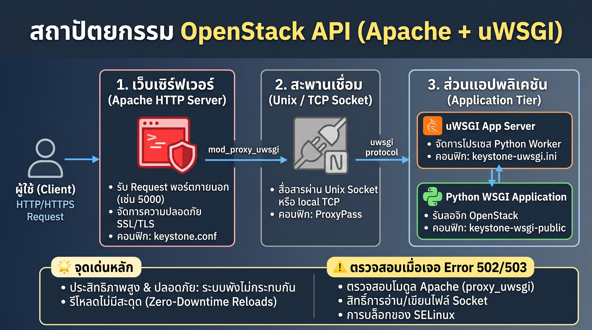
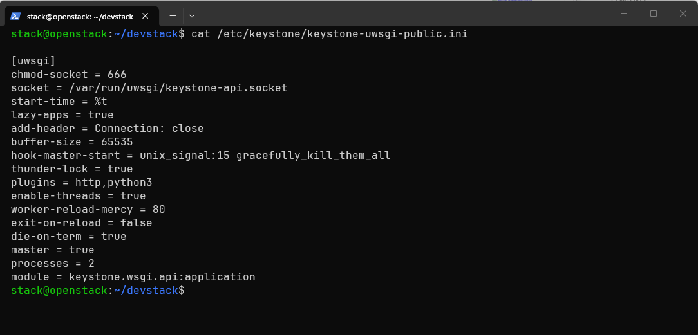
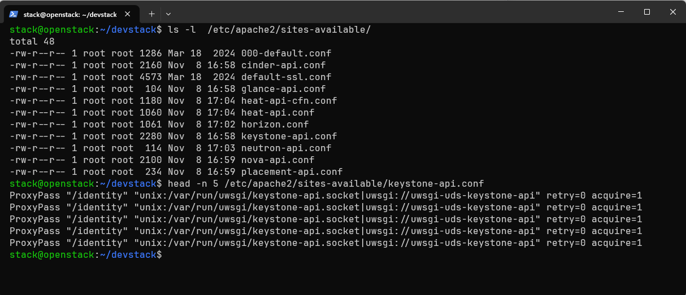
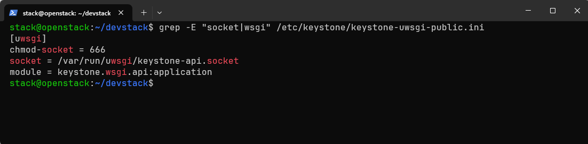
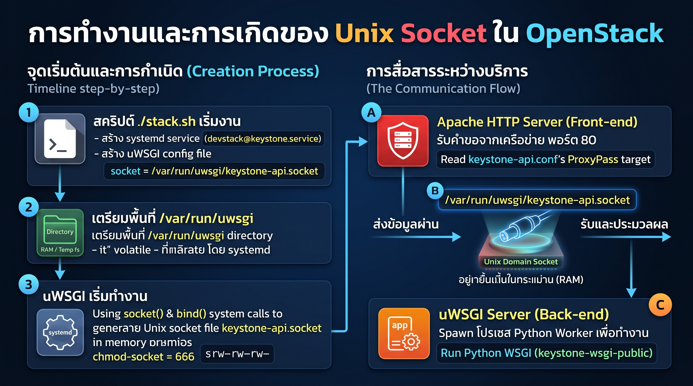
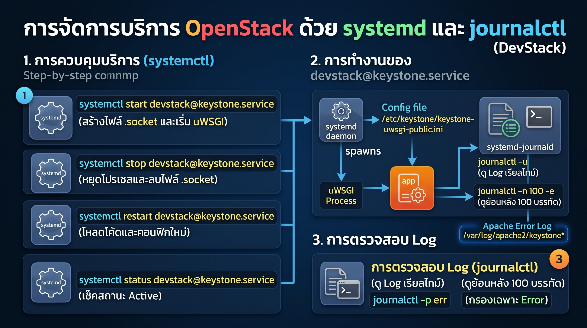

ใน OpenStack นั้น Apache ทำหน้าที่เป็น Reverse Proxy ที่คอยส่งต่อ HTTP Request ที่เข้ามาไปยัง uWSGI ซึ่งทำหน้าที่ครอบตัวแอปพลิเคชัน Python WSGI ไว้ และสื่อสารกันผ่านทาง Unix domain socket หรือ local TCP socket สถาปัตยกรรมนี้ช่วยแยกส่วนการจัดการ Request ของเว็บเซิร์ฟเวอร์ ออกจากการประมวลผลแอปพลิเคชัน Python อย่างชัดเจน

### ขั้นตอนการไหลของ Request (Request Flow)


แต่ละองค์ประกอบในระบบ (Stack) มีบทบาทหน้าที่เฉพาะตัวในการจัดการทราฟฟิกของ OpenStack API ดังนี้:

* **Apache HTTP Server (mod_proxy_uwsgi):** ทำหน้าที่รับฟัง (Listen) พอร์ตมาตรฐานภายนอก (เช่น 8774 สำหรับ Nova หรือ 5000 สำหรับ Keystone) และจัดการการเชื่อมต่อ SSL/TLS โดยใช้คำสั่ง `ProxyPass` ในการส่งต่อ Request ผ่านโปรโตคอล uwsgi ไปยังซ็อกเก็ตระบบหลังบ้าน (Backend Socket)
* **uWSGI Application Server:** ทำงานเป็น Background Daemon ที่ดูแลโดย `systemd` หน้าที่ของมันคือการสร้าง (Spawn) โปรเซส Python Worker ขึ้นมาหลายๆ ตัว, จัดการวงจรชีวิตของโปรเซส, และแปลงทราฟฟิกดิบจากซ็อกเก็ตให้เป็นการเรียกใช้งานโมดูล Python WSGI
* **Python WSGI Application:** ทำหน้าที่รันลอจิกการทำงานจริงของบริการ OpenStack (เช่น Keystone, Nova API หรือ Placement) ผ่านไฟล์ WSGI Entry Point (ตัวอย่างเช่น `/usr/bin/keystone-wsgi-public`)

---




### รูปแบบการตั้งค่ามาตรฐาน (Standard Configuration Pattern)

เครื่องมือสำหรับติดตั้ง OpenStack ส่วนใหญ่ (เช่น DevStack, Kolla หรือ OpenStack-Ansible) จะตั้งค่าระบบนี้ผ่านไฟล์หลัก 2 ไฟล์:

**1. ไฟล์ตั้งค่า uWSGI (`/etc/keystone/keystone-uwsgi.ini`)**
uWSGI จะสร้างซ็อกเก็ตและโหลดแอปพลิเคชัน Python:

```ini
[uwsgi]
# สร้าง Unix socket (หรือใช้ 127.0.0.1:8000 สำหรับ TCP)
socket = /var/run/uwsgi/keystone-public.socket
chmod-socket = 666

# โหลดไฟล์ OpenStack Python WSGI
wsgi-file = /usr/bin/keystone-wsgi-public

# การจัดการโปรเซส
master = true
processes = 4
threads = 1
die-on-term = true

```



**2. ไฟล์ Apache VirtualHost (`/etc/apache2/sites-available/keystone-api.conf`)**

ใน **DevStack เวอร์ชันปัจจุบัน** ได้เปลี่ยนรูปแบบการตั้งค่า Apache จากเดิมที่แยกพอร์ตตามแต่ละบริการ (เช่น พอร์ต 5000 สำหรับ Keystone, 8774 สำหรับ Nova) มาเป็นการใช้ **Path-based Routing (Subpath)** ผ่านพอร์ตมาตรฐาน 80/443 แทน และตั้งชื่อไฟล์คอนฟิกตามชื่อ systemd service คือ `keystone-api.conf`

ความแตกต่างหลักที่เกิดขึ้นในระบบของคุณมี 3 ประการดังนี้:

**1. การใช้ Subpath (`/identity`) แทนการแยกพอร์ต (`:5000`)**

* **แบบดั้งเดิม (Production/Manual Install):** ใช้ `<VirtualHost *:5000>` เพื่อเปิดพอร์ต 5000 แยกเฉพาะให้ Keystone
* **แบบ DevStack:** ไม่สร้าง `<VirtualHost>` แยกพอร์ต แต่ใช้คำสั่ง `ProxyPass "/identity"` เกาะไปกับพอร์ตหลัก (พอร์ต 80) ของ Apache เลย เวลาเรียก API ของ Keystone ใน DevStack URL จึงเป็น `http://<IP>/identity/v3/...` แทนที่จะเป็น `http://<IP>:5000/v3/...` (ซึ่งคุณสามารถตรวจสอบได้จากการรัน `openstack endpoint list` หรือดูค่า `OS_AUTH_URL` ในไฟล์ `openrc`)

**2. ชื่อไฟล์และ Socket อ้างอิงตามชื่อ Service ของ DevStack**
ใน DevStack บริการ Keystone ถูกรันในชื่อ `devstack@keystone.service` หรือ `keystone-api` ตัวสคริปต์ของ DevStack (`lib/apache` และ `lib/keystone`) จึงสร้างไฟล์คอนฟิกชื่อ:

* **Apache Config:** `/etc/apache2/sites-available/keystone-api.conf`
* **uWSGI Config:** `/etc/keystone/keystone-uwsgi-public.ini` (หรืออยู่ใน `/etc/keystone/`)
* **Unix Socket:** `/var/run/uwsgi/keystone-api.socket`

**3. ทำไมจึงมีบรรทัด `ProxyPass "/identity"` ซ้ำกันหลายบรรทัด?**
การที่คุณรัน `head -n 5` แล้วเห็นบรรทัดเดียวกันซ้ำกันหลายครั้ง เกิดจากการที่คุณอาจเคยสั่งรัน `./stack.sh` ซ้ำหลายรอบโดยไม่ได้รัน `./unstack.sh` หรือ `./clean.sh` ล้างค่าเก่าก่อน ฟังก์ชันเขียนคอนฟิกในสคริปต์ของ DevStack ใช้การต่อท้ายไฟล์ (Append) ลงใน `keystone-api.conf` จึงทำให้เกิดบรรทัดซ้ำกัน (แม้ Apache จะยังทำงานได้ตามปกติโดยยึดบรรทัดแรกเป็นหลัก แต่หากต้องการคลีนไฟล์ให้สะอาด สามารถลบให้เหลือบรรทัดเดียวแล้วสั่ง `sudo systemctl reload apache2` ได้ครับ)

คุณสามารถตรวจสอบไฟล์คอนฟิกฝั่ง uWSGI ของจริงที่คู่กับไฟล์นี้ใน DevStack ได้ด้วยคำสั่ง:

```bash
systemctl status devstack@keystone.service
```

บรรทัด `ExecStart` ในผลลัพธ์จะชี้ให้เห็นทันทีว่า `uwsgi` กำลังอ่านไฟล์ `.ini` ตัวไหนเพื่อสร้างไฟล์ `/var/run/uwsgi/keystone-api.socket` มารอรับทราฟฟิกจาก Apache ครับ




## /var/run/uwsgi/keystone-api.socket  เกิดมาได้อย่างไร

ไฟล์ `/var/run/uwsgi/keystone-api.socket` ไม่ใช่ไฟล์ปกติที่ถูกสร้างทิ้งไว้ถาวรในฮาร์ดดิสก์ แต่เป็น **Unix Domain Socket** ที่ถูกสร้างขึ้นแบบไดนามิกในหน่วยความจำ (RAM) โดย **systemd** และโปรเซส **uWSGI** เมื่อบริการ Keystone เริ่มทำงานครับ

สาเหตุที่ไฟล์นี้อยู่ใน `/var/run` (ซึ่งใน Ubuntu จะเชื่อมต่อไปยัง `/run` ที่เป็น `tmpfs` หรือ RAM Disk) ทำให้ทุกครั้งที่ Reboot เครื่อง ไฟล์นี้จะหายไปและถูกสร้างขึ้นใหม่ตามลำดับขั้นตอนต่อไปนี้ครับ:

### ลำดับการกำเนิดของไฟล์ `keystone-api.socket`

**1. จุดเริ่มต้นตอนรัน `./stack.sh` (สคริปต์ของ DevStack)**
เมื่อคุณรันติดตั้ง DevStack สคริปต์ `/opt/stack/devstack/lib/keystone` จะเรียกใช้ฟังก์ชันจาก `/opt/stack/devstack/lib/apache` เพื่อสร้างไฟล์ตั้งค่า 2 ส่วน:

* **ไฟล์ตั้งค่าของ uWSGI:** `/etc/keystone/keystone-uwsgi-public.ini` ซึ่งข้างในมีการระบุพาธเป้าหมายไว้ที่บรรทัด `socket = /var/run/uwsgi/keystone-api.socket`
* **ไฟล์ systemd service:** `/etc/systemd/system/devstack@keystone.service` สำหรับใช้สั่งรัน uWSGI ให้ทำงานเป็น Background Service

**2. การเตรียมโฟลเดอร์ชั่วคราว (`/var/run/uwsgi`)**
เนื่องจาก `/var/run` ถูกล้างค่าทุกครั้งที่เปิดเครื่องใหม่ ตัว systemd หรือสคริปต์เริ่มต้นระบบ (ผ่านกลไก `RuntimeDirectory=uwsgi` หรือ `tmpfiles.d`) จะทำการสร้างโฟลเดอร์ `/var/run/uwsgi/` เตรียมไว้ให้ และกำหนดสิทธิ์ให้ User `stack` สามารถเข้ามาเขียนไฟล์ได้

**3. จังหวะที่ไฟล์ `.socket` ถูกสร้างขึ้นจริง (โดย uWSGI)**
เมื่อ systemd สั่งรันเซอร์วิส `devstack@keystone.service` ระบบจะรันคำสั่ง:

```bash
/usr/local/bin/uwsgi --ini /etc/keystone/keystone-uwsgi-public.ini

```

ทันทีที่โปรเซส `uwsgi` อ่านไฟล์ `.ini` มันจะเรียกใช้คำสั่งระดับ OS (System Call ที่ชื่อว่า `socket()` และ `bind()`) เพื่อสร้างไฟล์พิเศษประเภท Socket ที่พาธ `/var/run/uwsgi/keystone-api.socket` พร้อมทั้งปรับสิทธิ์ไฟล์ (`chmod-socket = 666`) เพื่อให้ Apache (`www-data`) สามารถเข้ามาอ่านและส่งข้อมูลผ่านท่อนี้ได้

---

### วิธีตรวจสอบดูของจริงในเครื่อง DevStack ของคุณ

คุณสามารถไล่เช็คต้นตอของไฟล์นี้บน Terminal ได้ด้วย 3 คำสั่งนี้ครับ:

**1. ดูคุณสมบัติของไฟล์ Socket (สังเกตตัว `s` หน้าสุด)**

```bash
ls -la /var/run/uwsgi/keystone-api.socket

```

*ผลลัพธ์:* จะขึ้นต้นด้วย `srw-rw-rw-` ตัว **`s`** หมายถึงไฟล์ประเภท **Socket** (ไม่ใช่ไฟล์ธรรมดาที่ขึ้นต้นด้วย `-` หรือโฟลเดอร์ที่ขึ้นต้นด้วย `d`)

**2. ดูคำสั่งในไฟล์ `.ini` ที่เป็นคนสั่งให้สร้างไฟล์นี้**

```bash
grep -E "socket|wsgi" /etc/keystone/keystone-uwsgi-public.ini

```




*ผลลัพธ์:* คุณจะเห็นบรรทัด `socket = /var/run/uwsgi/keystone-api.socket` และ `chmod-socket = 666` ที่ DevStack เขียนตั้งค่าไว้

**3. ทดสอบการเกิดและหายไปของไฟล์**

* หากคุณสั่งหยุดเซอร์วิสด้วย `sudo systemctl stop devstack@keystone.service` โปรเซส uWSGI จะปิดตัวลงและทำลายไฟล์ `keystone-api.socket` ทิ้งทันที (ทำให้ Apache หาไฟล์ไม่เจอและเกิด Error 503/502)
* เมื่อสั่ง `sudo systemctl start devstack@keystone.service` ใหม่ โปรเซส uWSGI ก็จะสร้างไฟล์ `.socket` นี้ขึ้นมาใหม่อีกครั้งครับ


*(หมายเหตุ: หากใช้ TCP socket เช่น `127.0.0.1:8000` คำสั่งใน Apache จะเปลี่ยนเป็น `ProxyPass "/" "uwsgi://127.0.0.1:8000/"`)*





---

### ข้อดีหลักของสถาปัตยกรรมนี้

* **การแยกโปรเซส (Process Isolation):** หากโปรเซส Python Worker แคชหรือเกิดปัญหา Memory Leak ความเสียหายจะถูกจำกัดอยู่แค่ใน uWSGI ซึ่งมันจะสร้างโปรเซสขึ้นมาใหม่ (Respawn) โดยอัตโนมัติ ไม่ทำให้ฝั่งเว็บเซิร์ฟเวอร์ Apache ต้องล่มตามไปด้วย
* **ประสิทธิภาพและการทำงานพร้อมกัน (Performance and Concurrency):** Apache สามารถจัดการกับ Client ที่เชื่อมต่อช้า, การทำ Buffering, และกระบวนการ TLS Handshakes ได้อย่างมีประสิทธิภาพ ช่วยปล่อยให้ uWSGI Worker มีอิสระและโฟกัสไปที่การประมวลผลโค้ด Python ได้อย่างเต็มที่
* **การรีโหลดโดยไม่เกิดดาวน์ไทม์ (Zero-Downtime Reloads):** uWSGI รองรับการรีโหลด Python Worker แบบนุ่มนวล (Graceful Reloading) เมื่อไฟล์คอนฟิกของ OpenStack มีการเปลี่ยนแปลง ช่วยป้องกันปัญหา API Request หลุดหรือสูญหายระหว่างทาง

---

### Devstack ใช้ systemd ในการบริหาร Service



ในสภาพแวดล้อมของ DevStack บริการต่างๆ ของ OpenStack จะถูกควบคุมผ่าน `systemd` โดยใช้ชื่อเซอร์วิสนำหน้าด้วย `devstack@` การจัดการเซอร์วิสและการตรวจสอบ Log ของ Keystone สามารถทำได้ด้วยชุดคำสั่งต่อไปนี้ครับ

**1. การจัดการสถานะ Service (Start / Stop / Restart / Status)**

* **ตรวจสอบสถานะการทำงานปัจจุบัน (ดูว่า Active หรือไม่ และใช้ไฟล์ `.ini` ตัวไหน):**
```bash
sudo systemctl status devstack@keystone.service

```


* **สั่งหยุดการทำงาน (ไฟล์ `keystone-api.socket` จะถูกลบออกทันที):**
```bash
sudo systemctl stop devstack@keystone.service

```


* **สั่งเริ่มการทำงาน (uWSGI จะสร้างไฟล์ `keystone-api.socket` ขึ้นมาใหม่):**
```bash
sudo systemctl start devstack@keystone.service

```


* **สั่งรีสตาร์ท (ใช้เมื่อมีการแก้ไขโค้ด Python หรือแก้ไขไฟล์ `/etc/keystone/keystone.conf`):**
```bash
sudo systemctl restart devstack@keystone.service

```


**2. การดู Log ของ Keystone (ผ่าน `journalctl`)**
เนื่องจาก DevStack รันบริการผ่าน `systemd` ล็อกทั้งหมดของ uWSGI และ Keystone จะถูกส่งไปเก็บไว้ที่ `systemd-journald` โดยตรง สามารถเรียกดูได้ดังนี้:

* **ดู Log แบบเรียลไทม์ (Real-time / Follow) — แนะนำสำหรับใช้ตอนยิง API ทดสอบ:**
```bash
sudo journalctl -u devstack@keystone.service -f

```


*(กด `Ctrl + C` เพื่อออกจากโหมดดูแบบเรียลไทม์)*
* **ดู Log ย้อนหลังเฉพาะ 100 บรรทัดล่าสุด (พร้อมกระโดดไปบรรทัดท้ายสุด):**
```bash
sudo journalctl -u devstack@keystone.service -n 100 -e

```


* **ดู Log เฉพาะที่เกิด Error หรือระดับความรุนแรงสูง:**
```bash
sudo journalctl -u devstack@keystone.service -p err -e

```


* **ดู Log ตามช่วงเวลา (เช่น ตั้งแต่วันนี้ หรือย้อนหลัง 10 นาที):**
```bash
sudo journalctl -u devstack@keystone.service --since "10 minutes ago"

```


**3. การดู Log ฝั่ง Apache (กรณีเจอ Error 502 / 503 ก่อนถึง uWSGI)**
หากคำสั่งวิ่งมาไม่ถึง `devstack@keystone.service` (เช่น Apache คุยกับ Socket ไม่ได้) Log จะไปปรากฏที่ฝั่ง Apache แทน:

```bash
sudo tail -f /var/log/apache2/error.log /var/log/apache2/keystone*

```

**ทิปเพิ่มเติมสำหรับดูชื่อ Service อื่นๆ ใน DevStack:**
หากต้องการดูรายชื่อ Service ทั้งหมดของ OpenStack ที่ DevStack สร้างไว้ในเครื่อง เพื่อนำไปใช้กับคำสั่ง `systemctl` และ `journalctl` สามารถรันคำสั่งนี้ได้ครับ:

```bash
systemctl list-units "devstack@*"

```