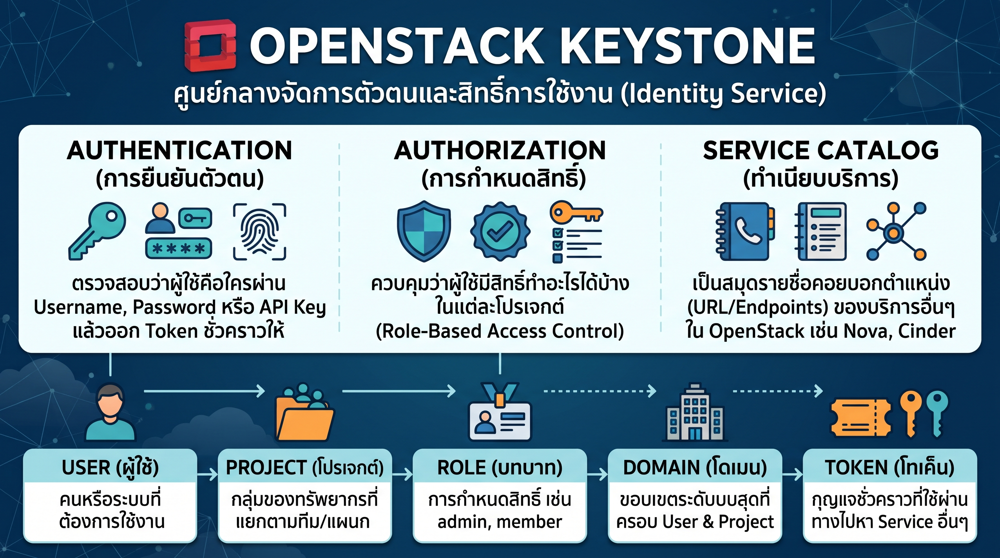
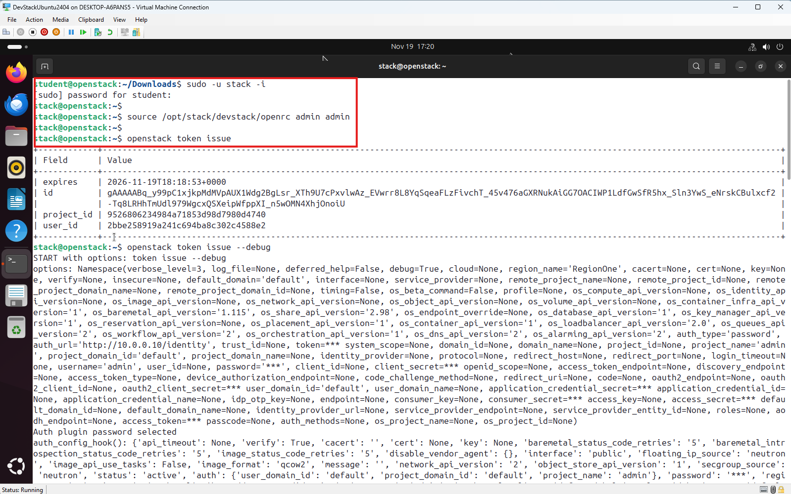
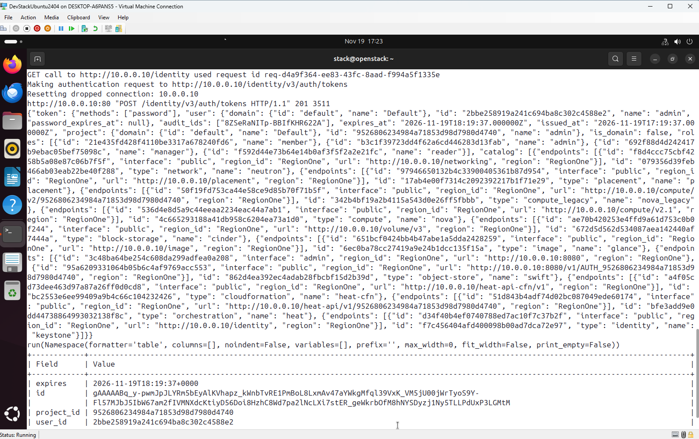
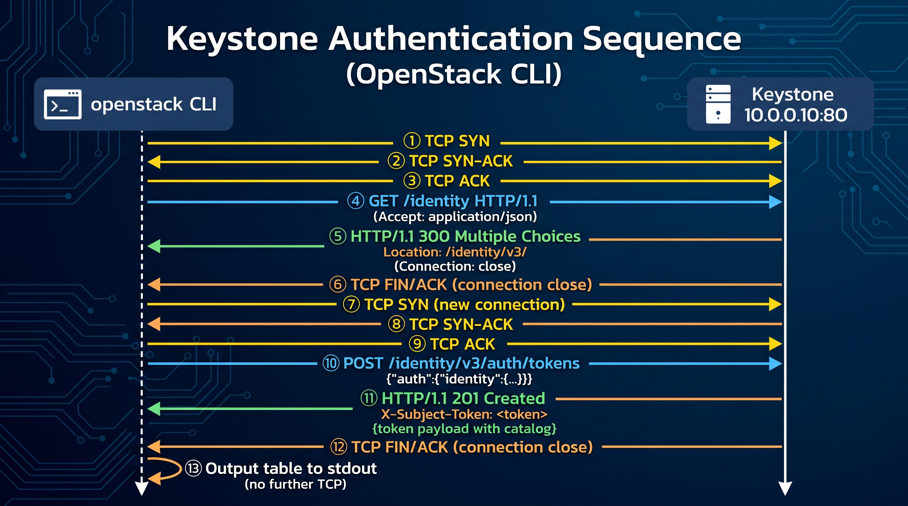
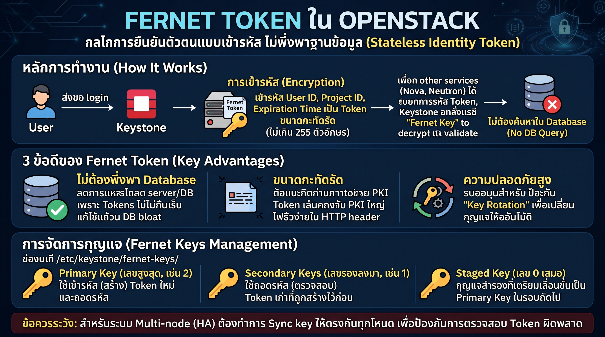

# การบรรยายที่ 3: Keystone — ระบบจัดการตัวตนและสิทธิ์

## วัตถุประสงค์การเรียนรู้

- เข้าใจความแตกต่างระหว่าง Authentication และ Authorization ใน OpenStack
- จัดการ Users, Projects, Roles และ Domains
- ทำงานกับ Service Catalog และ Endpoints


---

## Keystone คืออะไร?

**Keystone (OpenStack Identity Service)** คือบริการศูนย์กลางสำหรับจัดการ **การยืนยันตัวตน (Authentication)**, **การกำหนดสิทธิ์ (Authorization)** และ **ทำเนียบบริการ (Service Catalog)** ของระบบ OpenStack ทั้งหมด

### หน้าที่หลักของ Keystone

* **Authentication (ยืนยันตัวตน):** ตรวจสอบว่าผู้ใช้ (User) เป็นใคร ผ่าน Username/Password หรือ API Key แล้วออก **Token** ให้เพื่อนำไปใช้ติดต่อกับ Service อื่นๆ (เช่น Nova, Neutron, Cinder) โดยไม่ต้องส่งรหัสผ่านซ้ำ
* **Authorization (กำหนดสิทธิ์):** ควบคุมว่า User คนนั้นมีสิทธิ์ทำอะไรได้บ้าง (Role-Based Access Control - RBAC) ในขอบเขต (Project) ไหน
* **Service Catalog (ทำเนียบบริการ):** เก็บรายชื่อและ URL (Endpoints) ของ Service ทั้งหมดในระบบ OpenStack เพื่อให้ Service ต่างๆ ค้นหาและคุยกันได้

---

### โครงสร้างพื้นฐาน (Core Concepts)

* **User:** บัญชีผู้ใช้งาน (คน หรือ ระบบ)
* **Project (หรือ Tenant):** กลุ่มของทรัพยากร (เช่น VM, Network) ที่แยกออกจากกันตามทีมหรือแผนก
* **Role:** บทบาทหน้าที่ที่กำหนดสิทธิ์การใช้งาน เช่น `admin`, `member`, `reader`
* **Domain:** ขอบเขตระดับบนสุดที่ครอบ User และ Project อีกที (เช่น แยกตามบริษัทหรือองค์กร)
* **Token:** กุญแจชั่วคราวที่ Keystone ออกให้หลัง Login สำเร็จ เพื่อใช้ยืนยันสิทธิ์ในการเรียก API ของ OpenStack Service อื่นๆ






- ต่อท้าย คำสั่ง ด้วย `-debug`



---

## แนวคิดหลัก

Domain เป็นขอบเขตสำหรับจัดการ Users, Groups และ Projects โดย User กับ Project เป็นคนละรายการ ส่วน **Role Assignment** เชื่อมผู้ใช้หรือกลุ่มกับ Role ในขอบเขตที่กำหนด

| ผู้ใช้ใน Domain เดียวกัน | Role | ขอบเขตของ Role Assignment |
|---|---|---|
| บัญชีที่ 1 | `member` | Project A |
| บัญชีที่ 2 | `member` | Project A |
| บัญชีที่ 2 | `member` | Project B |

ผู้ใช้คนเดียวจึงมี Role Assignment ได้หลาย Project

### Domain
- Namespace ระดับสูงสุดสำหรับ Users, Groups และ Projects
- รองรับ Multi-tenancy ระดับองค์กร
- Domain เริ่มต้น: `default`

### Project (เดิมเรียกว่า Tenant)
- คอนเทนเนอร์สำหรับทรัพยากร (VMs, Networks, Volumes)
- ผู้ใช้ได้รับสิทธิ์ผ่าน Roles ภายใน Project

### User
- เอนทิตีที่แทนบุคคลหรือ Service Account
- ยืนยันตัวตนผ่าน Password, Token หรือ External IdP

### Role
- กำหนดชุดสิทธิ์ภายใน Project
- Roles ทั่วไป: `admin`, `member`, `reader`

### Group
- ชุดของ Users
- สามารถกำหนด Roles ให้ Group ได้เพื่อง่ายต่อการจัดการ

---

## การยืนยันตัวตนด้วย Token

```
User credentials → Keystone
    ↓
Keystone ตรวจสอบ credentials
    ↓
ออก Token ตาม scope ที่ขอและได้รับอนุญาต
    ↓
User นำ Token ไปแสดงต่อบริการอื่น ๆ
    ↓
บริการตรวจสอบ Token และใช้ Policy ของตนตัดสินสิทธิ์
```

### Project Scope

Token ที่มี Project Scope ใช้ในบริบทของ Project ที่ระบุ เมื่อสลับจาก Project A ไป Project B ระบบใช้ Token สำหรับ Project B และบริการตรวจสิทธิ์ตาม Role และขอบเขตของ Token นั้น ส่วน Unscoped Token ใช้ยืนยันตัวตนโดยยังไม่มี Roles, Service Catalog หรือขอบเขตการอนุญาต

### รูปแบบ Token (รวมรูปแบบในอดีต)

| รูปแบบ | คำอธิบาย |
|------|-------------|
| **UUID** | String สุ่ม ตรวจสอบโดย Keystone ทุกครั้ง |
| **PKI/PKIz** | Self-validating ลายเซ็น Cryptographic |
| **Fernet** | Default ใน OpenStack สมัยใหม่ มี Payload ที่เข้ารหัส |

**Fernet Token** คือรูปแบบของ Token มาตรฐานใน OpenStack Keystone ที่ใช้การเข้ารหัสแบบสมมาตร (Symmetric Encryption) เพื่อเก็บข้อมูลการยืนยันตัวตนไว้ในตัว Token เองโดยตรง ทำให้ **Keystone ไม่ต้องบันทึกลงฐานข้อมูล (Stateless)**

---

### หลักการทำงานของ Fernet Token

1. **การเข้ารหัส (Encryption):** เมื่อ User ล็อกอินผ่าน Keystone ระบบจะนำข้อมูลที่จำเป็น (เช่น User ID, Project ID, เวลาหมดอายุ) มาเข้ารหัสและลงลายมือชื่อดิจิทัล (HMAC-SHA256) ด้วยกุญแจลับ (Fernet Keys) ที่เก็บอยู่ในเครื่อง Server
2. **ขนาดกะทัดรัด:** ข้อมูลที่ถูกเข้ารหัสจะถูกแปลงเป็นข้อความสั้นๆ (ความยาวไม่เกิน 255 ตัวอักษร) ส่งกลับไปให้ Client ใน Header `X-Subject-Token`
3. **การตรวจสอบ (Validation):** เมื่อ Client นำ Token ไปเรียกใช้ Service อื่น (เช่น Nova) Service นั้นจะส่ง Token กลับมาให้ Keystone ตรวจสอบ Keystone เพียงแค่ใช้ Fernet Key ถอดรหัสและเช็กเวลาหมดอายุ โดยไม่ต้องวิ่งไป Query ฐานข้อมูลให้เสียเวลา

---

### ข้อดีของ Fernet Token (เทียบกับแบบเก่าเช่น UUID หรือ PKI)



* **ไม่ต้องพึ่งพา Database (No DB Overhead):** ลดภาระของ Database อย่างมหาศาล ไม่ต้องคอยลบ Token ที่หมดอายุออกจากตาราง (แก้ปัญหา Database บวมในระบบใหญ่)
* **ขนาดเล็ก ส่งผ่าน HTTP Header ได้สบาย:** ต่างจาก PKI Token ในอดีตที่มีขนาดใหญ่มากจนบางครั้งเกินขีดจำกัดของ Web Server
* **ความปลอดภัยสูงและหมุนเวียนกุญแจได้ (Key Rotation):** รองรับการเปลี่ยนกุญแจเข้ารหัสตามรอบเวลา โดยที่ Token เก่าที่ยังไม่หมดอายุยังสามารถใช้งานต่อไปได้จนกว่าจะครบกำหนด

---

### การจัดการ Fernet Keys (จุดสำคัญสำหรับผู้ดูแลระบบ)

การสร้างและจัดการกุญแจจะใช้คำสั่ง `keystone-manage` โดยมีสถานะของไฟล์กุญแจ (เก็บอยู่ที่ `/etc/keystone/fernet-keys/`) แบ่งเป็น 3 ประเภทตามชื่อไฟล์ที่เป็นตัวเลข:

* **Primary Key (เลขสูงสุด เช่น `2`):** ใช้สำหรับ **เข้ารหัส (สร้าง)** Token ใหม่ และ **ถอดรหัส** Token ที่สร้างจากกุญแจนี้
* **Secondary Keys (เลขรองลงมา เช่น `1`):** ใช้สำหรับ **ถอดรหัส (ตรวจสอบ)** Token เก่าที่ถูกสร้างไว้ก่อนจะมีการเปลี่ยนกุญแจเท่านั้น
* **Staged Key (ไฟล์ชื่อ `0` เสมอ):** กุญแจที่เตรียมพร้อมไว้ล่วงหน้า เมื่อถึงรอบการหมุนเวียนกุญแจ (Key Rotation) ไฟล์ `0` จะถูกเลื่อนขั้นเป็น Primary Key ตัวใหม่


---

## Service Catalog และ Endpoints

Keystone เก็บ Catalog ของทุกบริการ OpenStack:

| ประเภท Endpoint | หน้าที่ |
|---------------|---------|
| **public** | API สำหรับภายนอก |
| **internal** | การสื่อสารระหว่างบริการภายใน |
| **admin** | การดำเนินการระดับ Admin |

ตัวอย่าง:
```yaml
Service: compute (nova)
  public:   https://cloud.muict.ac.th:8774/v2.1
  internal: http://10.0.0.11:8774/v2.1
  admin:    http://10.0.0.11:8774/v2.1
```

---

## ไฟล์ Policy

แต่ละบริการมี `policy.json` หรือ `policy.yaml` ที่จัด mapping ระหว่าง Roles กับ API Operations:

```yaml
# ตัวอย่าง: เฉพาะ admin สามารถสร้าง flavors ได้
"os_compute_api:os-flavor-manage:create": "rule:admin_api"
```

---

## Federated Identity

Keystone รองรับ External Identity Providers:

- **LDAP** — Active Directory, OpenLDAP
- **SAML 2.0** — Shibboleth, ADFS
- **OpenID Connect** — Google, Keycloak

ช่วยให้สามารถใช้ Single Sign-On (SSO) กับ OpenStack ได้

---

## คำสั่งใช้งานจริง

```bash
# แสดงรายการ Users
openstack user list

# สร้าง Project
openstack project create --description "โครงการนักศึกษา" student-project

# กำหนด Role ให้ User ใน Project
openstack role add --user alice --project student-project member

# ขอ Token
openstack token issue
```

---

## Workshop ท้ายบท — ทดลอง Project Scope บน DevStack

**เวลา** 45–60 นาที · **รูปแบบ** กลุ่มละ 2–3 คน

### สิ่งที่ผู้สอนเตรียม

- สร้าง Project A และ B ใน Domain เดียวกัน และเตรียม VM ชื่อแตกต่างกันหนึ่งเครื่องต่อ Project เช่น `keystone-a-vm` และ `keystone-b-vm`
- เตรียมบัญชีทดสอบตามตาราง Role Assignment ด้านบน และตรวจล่วงหน้าว่าบัญชีแรกเข้าได้เฉพาะ Project A ส่วนบัญชีที่สองเข้าได้ทั้งสอง Project
- ตั้งค่า OpenStack CLI profiles `keystone-a` และ `keystone-b` ให้ใช้บัญชีที่สอง โดยแต่ละ profile ขอ Token สำหรับ Project ที่ตรงกับชื่อ

### ขั้นที่ 1 — เปรียบเทียบบัญชีใน Horizon (10 นาที)

เข้าสู่ Horizon ด้วยบัญชีแรก จด Project ที่เลือกได้ และชื่อ VM ใน **Project → Compute → Instances** จากนั้นออกจากระบบ เข้าด้วยบัญชีที่สอง และเปรียบเทียบรายชื่อ Project

### ขั้นที่ 2 — สลับ Project ด้วยบัญชีเดิม (10–15 นาที)

ด้วยบัญชีที่สอง เลือก Project A แล้วบันทึกชื่อและ UUID ของ VM ที่เห็น ทำซ้ำกับ Project B หากผลต่างจากที่คาด ให้บันทึกผลจริงและให้ผู้สอนตรวจ Project ที่เลือกกับ Role Assignment ของบัญชี

### ขั้นที่ 3 — ตรวจสอบผลด้วย CLI (15–20 นาที)

```bash
for cloud in keystone-a keystone-b; do
  printf '\nProfile: %s\n' "$cloud"
  openstack --os-cloud "$cloud" token issue -c project_id -c expires
  openstack --os-cloud "$cloud" server list
  openstack --os-cloud "$cloud" catalog list
done
```

1. เทียบ `project_id` และ UUID ของ VM จาก CLI กับผลใน Horizon
2. หา Endpoint ของบริการ `compute` ใน Catalog จด Region และ Interface ที่พบ แล้วดูว่าทั้งสองโปรไฟล์ชี้ไปยังบริการเดียวกันหรือไม่
3. บันทึกเฉพาะข้อมูลที่ใช้ตอบโจทย์ ให้รหัสผ่าน ค่า Token และไฟล์ Credentials อยู่ในเครื่องทดสอบ

### งานส่ง (10–15 นาที)

ส่งตาราง **บัญชี | Project | Project ID (เมื่อมี) | VM ที่เห็น** พร้อมหลักฐานจาก Horizon และ CLI แล้วตอบว่า **เหตุใดผู้ใช้คนเดิมที่มี Role `member` ในทั้งสอง Project จึงเห็น VM คนละชุดเมื่อสลับ Project** ให้แยกบทบาทของ Authentication, Role Assignment, Project Scope และ Policy ในคำตอบ

## สไลด์การบรรยาย

📥 [ดาวน์โหลดสไลด์การบรรยายที่ 3 (PDF)](../assets/slides/Keystone%20ระบบจัดการตัวตนและสิทธิ์.pdf){ .md-button }

## แหล่งข้อมูลเพิ่มเติม

- [Keystone Administrator Guide](https://docs.openstack.org/keystone/latest/admin/)
- [Keystone — Default Roles](https://docs.openstack.org/keystone/latest/admin/service-api-protection.html)
- [Keystone — Token Scopes](https://docs.openstack.org/keystone/latest/admin/tokens-overview.html)
