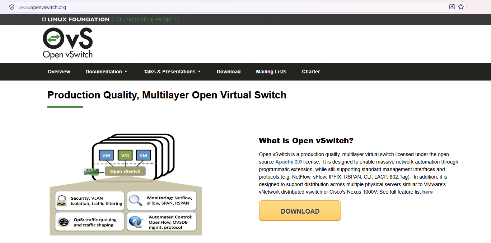
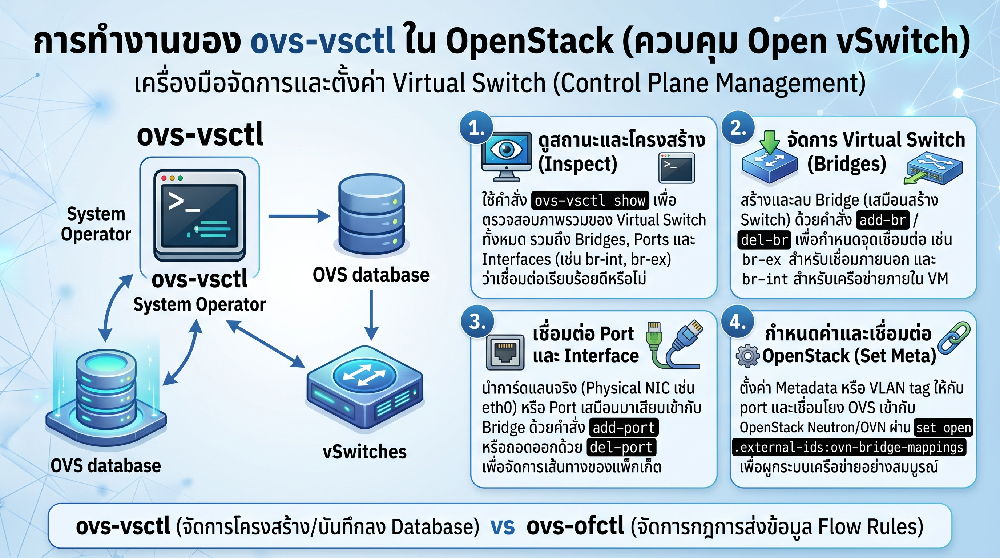
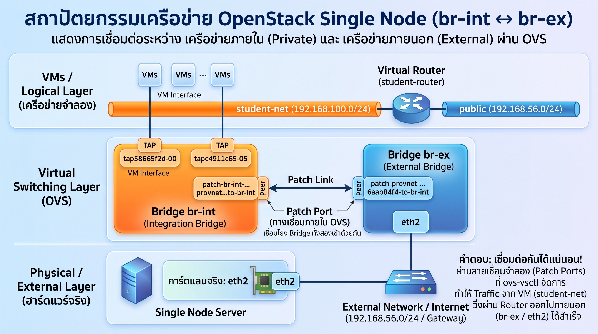
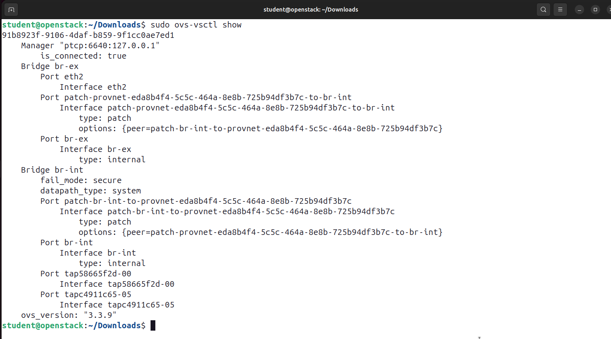

## Open vSwitch : Network As Service  ใน Openstack

!!! note  "What is Open vSwitch?"
    Open vSwitch is a production quality, multilayer virtual switch licensed under the open source Apache 2.0 license.  It is designed to enable massive network automation through programmatic extension, while still supporting standard management interfaces and protocols (e.g. NetFlow, sFlow, IPFIX, RSPAN, CLI, LACP, 802.1ag).  In addition, it is designed to support distribution across multiple physical servers similar to VMware's vNetwork distributed vswitch or Cisco's Nexus 1000V. See full feature list here

**`ovs-vsctl`** (ย่อมาจาก **Open vSwitch Control**) คือคำสั่งหลักสำหรับ **ตั้งค่าและจัดการโครงสร้างของ Open vSwitch (OVS)** ผ่านการสื่อสารกับฐานข้อมูล `ovsdb-server` ครับ *(หมายเหตุ: ตัวสะกดที่ถูกต้องคือ `ovs-vsctl` ไม่มี `vs` ซ้ำครับ)*

[โปรเจค  https://www.openvswitch.org/](https://www.openvswitch.org/)

ในระบบ OpenStack Neutron คำสั่งนี้เปรียบเสมือน **"เครื่องมือควบคุม Virtual Switch (Control Plane Management)"** โดยทำหน้าที่หลักๆ ดังนี้:

### 1. ดูโครงสร้างและสถานะทั้งหมด (Inspect)

* **`sudo ovs-vsctl show`** — แสดงภาพรวมทั้งหมดของ OVS บนเครื่อง ทั้ง Bridge (เช่น `br-int`, `br-ex`), Port, Interface (เช่น `eth0`, `patch-*`, `vxlan-*`) รวมถึงแจ้ง Error หาก Interface ใดเชื่อมต่อไม่สำเร็จ

### 2. สร้างและจัดการ Bridge (Virtual Switch)

* **`sudo ovs-vsctl add-br <ชื่อ_bridge>`** — สร้าง Virtual Switch ตัวใหม่ (เช่น `br-ex`)
* **`sudo ovs-vsctl del-br <ชื่อ_bridge>`** — ลบ Virtual Switch
* **`sudo ovs-vsctl list-br`** — แสดงรายชื่อ Bridge ทั้งหมดที่มีอยู่ในเครื่อง

### 3. เชื่อมต่อและจัดการ Port / Interface

* **`sudo ovs-vsctl add-port <bridge> <interface>`** — นำการ์ดแลนจริง (เช่น `eth0`) หรือ Virtual Interface เข้าไปเสียบกับ Bridge
* **`sudo ovs-vsctl del-port <bridge> <interface>`** — ถอด Interface ออกจาก Bridge
* **`sudo ovs-vsctl list-ports <bridge>`** — ดูรายชื่อ Port ทั้งหมดที่เชื่อมต่ออยู่กับ Bridge นั้นๆ

### 4. ตั้งค่า VLAN และ Metadata / External IDs

* **`sudo ovs-vsctl set port <port> tag=<vlan_id>`** — กำหนด VLAN Tag ให้กับ Port (Access Mode)
* **`sudo ovs-vsctl get/set open . external-ids:...`** — ดูหรือตั้งค่าพารามิเตอร์ที่เชื่อมกับระบบอื่น เช่น `ovn-bridge-mappings` หรือ `ovn-remote` สำหรับการเชื่อม OVS เข้ากับ OpenStack OVN

---

### ข้อแตกต่างกับคำสั่ง OVS ตัวอื่นที่มักเจอบ่อย

เพื่อให้ไม่สับสนเวลาใช้งานใน OpenStack:

* **`ovs-vsctl` (Configuration):** จัดการโครงสร้าง (สร้าง Switch, เสียบสาย Port, ตั้ง VLAN) — *ค่าที่ตั้งจะถูกบันทึกลง Database ถาวร*
* **`ovs-ofctl` (OpenFlow Rules):** ดูและจัดการ Flow Table / กฎการส่งต่อแพ็กเก็ต (เช่น Allow, Drop, NAT, Forward)
* **`ovs-dpctl` / `ovs-appctl` (Datapath & Runtime):** ตรวจสอบการทำงานระดับ Kernel Datapath และดีบักการทำงานขณะรันจริง

## จาก network เรียนรู้อะไรบ้าง

- คำสั่ง 

เส้นทางการเดินทางของข้อมูล (**Traffic Flow**) จาก VM ภายในออกสู่เครือข่ายภายนอก (External Network) บนเครื่อง Single Node ของคุณ (อ้างอิงจากค่าใน `ovs-vsctl show` และ Network Topology) มีลำดับขั้นตอนดังนี้ครับ:

1. **จุดเริ่มต้นที่ VM (Instance):**
VM ส่งแพ็กเก็ตข้อมูลออกจากการ์ดแลนเสมือนของตัวเอง โดยใช้ IP ต้นทางในวงภายใน (`192.168.100.x`) และชี้ปลายทางไปที่ Gateway (`192.168.100.1`)

2. **เข้าสู่ Integration Bridge (`br-int`) ผ่าน TAP Interface:**
แพ็กเก็ตวิ่งผ่านสายเชื่อมต่อเสมือนที่ชื่อ **`tap58665f2d-00`** (หรือ `tapc4911c65-05` ขึ้นอยู่กับตัว VM) เข้ามาที่สวิตช์หลักภายใน **`br-int`** ซึ่งเป็นศูนย์กลางเครือข่ายของ VM ทั้งหมดในระบบ

3. **ประมวลผล Router และ NAT (OVN Logical Router `student-router`):**
เมื่อแพ็กเก็ตถึง **`br-int`** กลไกของ OpenStack (OVN) จะประมวลผลเสมือนส่งข้อมูลผ่านเราเตอร์ **`student-router`** เพื่อทำ **Routing** ข้ามวงเครือข่าย (จาก `student-net` `192.168.100.0/24` ไปยัง `public` `192.168.56.0/24`) พร้อมทำ **SNAT** เปลี่ยน IP ต้นทางจาก Private IP เป็น IP ขาออกของ Router (หรือ Floating IP ของ VM นั้น)

4. **ข้ามสะพานผ่านสายเชื่อมจำลอง (Patch Link):**
แพ็กเก็ตที่แปลง IP แล้วจะวิ่งออกจาก `br-int` ทางพอร์ต **`patch-br-int-to-provnet-...`** ข้ามสะพานไปยังพอร์ตคู่แฝด (Peer) ชื่อ **`patch-provnet-...-to-br-int`** เพื่อเข้าสู่ **`br-ex`**

5. **ออกสู่โลกภายนอกผ่าน External Bridge (`br-ex`) และการ์ดแลนจริง (`eth2`):**
เมื่อแพ็กเก็ตเข้ามาอยู่ใน **`br-ex`** จะถูกส่งต่อไปยังพอร์ต **`eth2`** ซึ่งเป็น Physical NIC ของเครื่อง Server จากนั้นจึงวิ่งออกสู่ Physical Switch / Gateway (`192.168.56.0/24`) และอินเทอร์เน็ตภายนอกได้สำเร็จ

*(ส่วนขากลับ **Return Traffic** จากภายนอกเข้าหา VM ข้อมูลจะวิ่งย้อนกลับตามเส้นทางเดิม: `eth2` --> `br-ex` --> `Patch Port` --> `br-int` (แปลง IP กลับด้วย DNAT/Conntrack) --> `TAP Interface` --> `VM`)*

## ทำความเข้าใจเรื่อง Virtual network device 
ทำความเข้าใจเรื่อง Virtual network device หากนำคำนิยามเหล่านี้มาเรียงต่อกันเป็นอุปกรณ์จริงในห้อง Server จะได้ภาพรวมดังนี้ครับ:

* **TAP (`tap58665f2d-00`) = Virtual Network Port / Virtual NIC (การ์ดแลนเสมือนของ VM)**
ทำหน้าที่เป็นจุดเชื่อมต่อระหว่างระบบปฏิบัติการภายในตัว VM (Guest OS) ออกมาหาตัวเครื่อง Host / Virtual Switch เปรียบเสมือนปลั๊กสายแลนที่เสียบอยู่หลังเครื่องคอมพิวเตอร์ (VM)

* **`br-int` และ `br-ex` = Virtual Switch (สวิตช์เสมือน)**

* **`br-int` (Integration Bridge):** สวิตช์หลักภายในที่รวมสายจาก VM ทุกตัวเข้าด้วยกัน

* **`br-ex` (External Bridge):** สวิตช์ตัวนอกที่ต่ออยู่กับการ์ดแลนจริงของเครื่อง (`eth2`) เพื่อเตรียมส่งข้อมูลออกนอกเครื่อง

* **Patch Link (`patch-br-int-to-provnet...` <-> `patch-provnet...`) = Virtual Patch Cord (สายแลนเสมือนแบบ Cross/Uplink)**
ทำหน้าที่เป็น "สายแลนเสมือน" ที่เสียบเชื่อมระหว่างพอร์ตของ Virtual Switch ตัวที่ 1 (`br-int`) เข้ากับพอร์ตของ Virtual Switch ตัวที่ 2 (`br-ex`) เพื่อให้แพ็กเก็ตวิ่งข้ามหากันได้โดยไม่ต้องใช้สายไฟเบอร์หรือสายแลนจริง

* **`student-router` = Virtual Router (เราเตอร์เสมือน)**
ทำหน้าที่หาเส้นทางข้ามวงเครือข่าย (จากวง `192.168.100.0/24` ไปยัง `192.168.56.0/24`) และทำหน้าที่แปลง IP (NAT) เหมือนเราเตอร์บ้านหรือเราเตอร์องค์กรทั่วไป (ในสถาปัตยกรรม OVN ตัวเราเตอร์นี้จะทำงานแบบกระจายตัวฝังอยู่ใน Flow Rules ของ `br-int`)

---

### สรุปภาพรวมเมื่อเปรียบเทียบเป็นห้อง Server จริง

> **VM** เสียบสายผ่าน **การ์ดแลนเสมือน (TAP)** --> วิ่งเข้า **สวิตช์ตัวใน (`br-int`)** --> แวะผ่าน **เราเตอร์เสมือน (`student-router`)** เพื่อแปลง IP --> วิ่งข้าม **สายแลนเสมือน (Patch Link)** --> เข้าสู่ **สวิตช์ตัวนอก (`br-ex`)** --> แล้วออกทาง **พอร์ตแลนจริง (`eth2`)** สู่โลกภายนอก
> 
