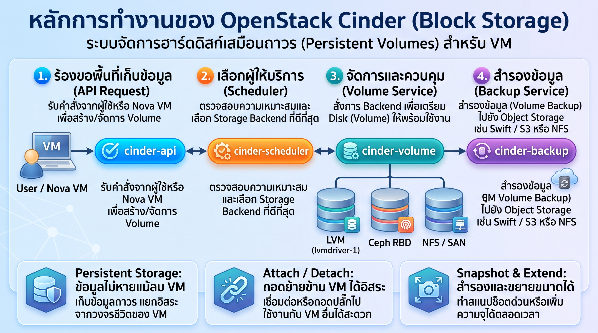

# การบรรยายที่ 7: Cinder — บริการ Block Storage

## วัตถุประสงค์การเรียนรู้

- แยกหน้าที่ของ Image, ดิสก์ระบบ และ Data Volume
- อธิบายว่า Cinder และ Nova ทำงานร่วมกันอย่างไรเมื่อ Attach Volume
- ย้าย Volume ระหว่าง VM สองเครื่องและตรวจสอบว่าข้อมูลยังอยู่



## Cinder ทำอะไร?

**OpenStack Cinder** คือบริการจัดการพื้นที่จัดเก็บข้อมูลแบบ **Block Storage-as-a-Service** ทำหน้าที่สร้างและจัดการฮาร์ดดิสก์เสมือนถาวร (**Persistent Volumes**) เพื่อนำไปเสียบใช้งานกับ Instance (VM) เสมือนการนำฮาร์ดดิสก์หรือ External Hard Drive ไปต่อเพิ่มให้กับเครื่องคอมพิวเตอร์

---

### 1. จุดเด่นและหลักการทำงานสำคัญ

* **Persistent Storage (ข้อมูลถาวร):** ข้อมูลที่เก็บใน Cinder Volume จะไม่สูญหายแม้ว่าจะปิด (Shutoff) หรือลบ (Delete) ตัว VM ทิ้งไป (ต่างจาก Ephemeral Disk ของ Nova ที่จะหายไปพร้อมกับ VM)
* **Attach / Detach ได้อิสระ:** สามารถถอด Volume ออกจาก VM เครื่องหนึ่ง แล้วนำไปเสียบเข้ากับ VM อีกเครื่องหนึ่งได้ทันที เพื่อย้ายข้อมูลหรือกู้คืนระบบ
* **Boot from Volume:** สามารถนำไฟล์ Image จาก Glance มาลงใน Cinder Volume แล้วสั่งให้ VM บูตจาก Volume นี้โดยตรงได้ (เหมือนที่คุณตั้งค่า `Create New Volume = Yes` ในหน้า Launch Instance)


---

### 2. สถาปัตยกรรมและบริการย่อย (Components)

* **`cinder-api`:** ด่านหน้าคอยรับคำสั่ง API จากผู้ใช้ (Dashboard / CLI) หรือจาก Nova (เช่น คำสั่งสร้าง ขยายขนาด หรือเสียบ Volume)
* **`cinder-scheduler`:** ทำหน้าที่ตัดสินใจเลือก Storage Backend ที่เหมาะสมที่สุดในการสร้าง Volume (เช่น ดูจากพื้นที่ว่างหรือ Volume Type ที่เลือก)
* **`cinder-volume`:** ตัวทำงานหลักที่สื่อสารกับฮาร์ดแวร์/ซอฟต์แวร์ Storage จริงผ่าน Driver ต่างๆ เช่น **LVM** (`lvmdriver-1` บน DevStack), **Ceph RBD**, **NFS**, **iSCSI** หรือ Enterprise SAN Storage


* **`cinder-backup`:** บริการสำหรับสำรองข้อมูลของ Volume ออกไปเก็บไว้ภายนอก เช่น เก็บลง Object Storage (Swift / S3)

---

### 3. ฟีเจอร์หลักที่ใช้งานบ่อย

* **Snapshot:** ถ่ายภาพสถานะของ Volume ณ เวลานั้นเก็บไว้ เพื่อใช้กู้คืนหรือสร้างเป็น Volume ก้อนใหม่
* **Extend Volume:** ขยายขนาดพื้นที่ของ Volume ให้ใหญ่ขึ้นได้เมื่อพื้นที่เดิมใกล้เต็ม
* **Volume Types:** การจัดกลุ่มระดับความเร็วหรือชนิดของ Storage (เช่น SSD vs HDD, หรือ `lvmdriver-1`) เพื่อให้ผู้ใช้เลือกตามความเหมาะสมของงาน


---

### เปรียบเทียบกับ Storage ตัวอื่นใน OpenStack เพื่อไม่ให้สับสน

| บริการ | ประเภท Storage | ลักษณะการใช้งาน |
| --- | --- | --- |
| **Cinder** | **Block Storage** | ฮาร์ดดิสก์เสมือนสำหรับเสียบเข้า VM (เก็บ OS, Database) |
| **Swift** | **Object Storage** | พื้นที่เก็บไฟล์ผ่าน API (เก็บไฟล์ Backup, รูปภาพ, วิดีโอ คล้าย Amazon S3) |
| **Glance** | **Image Service** | คลังเก็บไฟล์ต้นแบบระบบปฏิบัติการ (OS Image เช่น `.qcow2`, `.iso`) |

ใน [Lecture 06](lecture06-glance.md) เราใช้ Image เป็นต้นแบบบูต VM ถ้าต้องการแยกข้อมูลของแอปออกจากดิสก์ระบบ ให้สร้าง **Data Volume** ด้วย Cinder แล้ว Attach เข้า VM ระบบปฏิบัติการจะเห็นเป็นอุปกรณ์แบบ Block Device และสามารถสร้าง Filesystem หรือใช้เป็นดิสก์ให้แอปได้

| ทรัพยากร | ใช้ทำอะไร | วงจรชีวิต |
|---|---|---|
| **Glance Image** | ต้นแบบสำหรับบูต VM หรือสร้าง Boot Volume | มี Image UUID ของตนเอง |
| **Root Disk ที่ Nova จัดการ** | เก็บ OS และไฟล์บนดิสก์ระบบเมื่อบูตจาก Image โดยตรง | ผูกกับ Instance และถูกลบเมื่อ Instance ถูกลบ |
| **Cinder Volume** | เป็น Data Disk หรือ Root Disk เมื่อเลือก Boot from Volume | มี Volume UUID แยกจาก Instance โดยการลบพร้อม VM ขึ้นกับการตั้งค่า Delete on Termination |

## จากคำขอสร้าง Volume ถึงดิสก์ใน VM

1. **cinder-api** รับคำขอ เช่น สร้าง Volume ขนาด 1 GiB
2. **cinder-scheduler** เลือก Backend ตาม Volume Type, ความจุ และเงื่อนไขที่กำหนด
3. **cinder-volume** เรียก Driver เพื่อสร้างหรือจัดการ Volume บน Backend เช่น LVM, Ceph RBD หรือ NFS ส่วน iSCSI และ Fibre Channel เป็นวิธีเชื่อมต่อ Storage ที่บาง Driver ใช้
4. เมื่อสั่ง **Attach** ผ่าน Nova ระบบประสานกับ Cinder เพื่อให้ Compute Host เชื่อมต่อ Volume และให้ VM เห็นเป็นดิสก์ จากนั้น Guest OS จัดการ Filesystem และ Mount Point

**Volume Type** คือชุดคุณสมบัติที่ผู้ดูแลกำหนด เช่น นโยบายเลือก Backend หรือความสามารถ Multiattach ที่ต้องรองรับทั้ง Type และ Backend ในกิจกรรมนี้ใช้ Volume ปกติที่แนบทีละ VM

## Snapshot, Backup และ Boot from Volume

| หัวข้อ | ใช้เมื่อใด |
|---|---|
| **Volume Snapshot** | เก็บจุดอ้างอิงของข้อมูลบน Volume แล้วใช้สร้าง Volume ใหม่ได้ ควรหยุดงานเขียนและทำให้ข้อมูลของแอปอยู่ในสถานะที่สอดคล้องกันก่อน Snapshot |
| **Volume Backup** | สำรองข้อมูลผ่าน `cinder-backup` ไปยังปลายทางที่ตั้งค่าไว้ เช่น Swift, Ceph หรือ NFS การแยกความเสี่ยงขึ้นกับตำแหน่งปลายทางจริง |
| **Instance Snapshot** | ใช้เก็บสถานะดิสก์สำหรับสร้าง Instance ใหม่ วิธีจัดเก็บขึ้นกับแหล่งบูตของ VM การทำ Snapshot แบบนี้ไม่บันทึก RAM หรือสถานะการทำงานของ CPU |
| **Boot from Volume** | ใช้ Cinder Volume เป็นดิสก์ระบบ เช่น สร้าง Volume จาก Glance Image ก่อนบูต การย้ายโฮสต์ยังขึ้นกับ Backend และการตั้งค่าของ Nova |

หากขยาย Volume ต้องตรวจขนาด Block Device และขยาย Partition หรือ Filesystem ภายใน Guest ตามที่ใช้ การเพิ่มขนาดใน Cinder เป็นเพียงขั้นแรก

## Workshop ท้ายบท — ย้าย Data Volume จาก VM-A ไป VM-B

**ระบบ** DevStack OpenStack Hibiscus (2026.2) · **เวลา** 50–65 นาที · **รูปแบบ** กลุ่มละ 2–3 คน

### สิ่งที่ผู้สอนเตรียม

- Project ที่มีสิทธิ์ใช้ Cinder และโควตาสำหรับ Volume 1 GiB ตรวจ `openstack volume list` ล่วงหน้า และทดลองสร้าง Volume จนเป็น `available`
- VM-A และ VM-B ใน Project เดียวกัน ใช้ Image Linux ที่มี `lsblk`, `mkfs.ext4`, `mount` และ `sha256sum` พร้อมสิทธิ์ `sudo` ภายใน Guest ใช้ Console ได้โดยไม่ต้องตั้ง Floating IP
- ตรวจล่วงหน้าว่า Volume สามารถแนบกับ VM ทั้งสองได้ตาม Availability Zone และการตั้งค่าของ Lab

### ขั้นที่ 1 — สร้างและ Attach (15–20 นาที)

บันทึกผล `lsblk -f` ใน VM-A ก่อนแนบดิสก์ จาก OpenStack CLI สร้าง Volume ใหม่โดยแทน `XX` ด้วยเลขกลุ่ม

```bash
openstack volume create --size 1 lec07-teamXX-data
```

คัดลอก UUID ของ Volume และของ VM ทั้งสอง แล้วตั้งค่าตัวแปรใน Bash ที่ใช้ OpenStack CLI

```bash
VOLUME_ID='แทนด้วย Volume UUID'
VM_A='แทนด้วย VM-A UUID'
VM_B='แทนด้วย VM-B UUID'

openstack volume show "$VOLUME_ID" -c status -c attachments
openstack server add volume "$VM_A" "$VOLUME_ID"
```

รันคำสั่ง Attach หลัง Volume เป็น `available` จากนั้นตรวจ `volume show` ซ้ำจนเป็น `in-use` และ Attachment ชี้ไปที่ VM-A

### ขั้นที่ 2 — เขียนข้อมูลแล้ว Detach (15–20 นาที)

ใน Console ของ **VM-A** เทียบผล `lsblk -f` ก่อนกับหลัง Attach ให้ผู้สอนช่วยยืนยันว่าอุปกรณ์ที่เพิ่มมาคือ **Volume ใหม่ที่ว่าง** ตรวจจากขนาดและรายการอุปกรณ์ที่เพิ่มขึ้น จากนั้นจึงแทน Path ด้านล่างด้วยอุปกรณ์จริง ชื่ออุปกรณ์อาจต่างกันในแต่ละ VM ให้รันทีละบรรทัดและหยุดหาก Format หรือ Mount ไม่สำเร็จ

```bash
DEVICE='/dev/REPLACE_WITH_VERIFIED_NEW_DISK'
sudo mkfs.ext4 "$DEVICE"
sudo mkdir -p /mnt/cinder-lab
sudo mount "$DEVICE" /mnt/cinder-lab
printf '%s\n' 'lec07-teamXX' | sudo tee /mnt/cinder-lab/proof.txt
sha256sum /mnt/cinder-lab/proof.txt
sudo umount /mnt/cinder-lab
```

จด SHA-256 แล้วกลับไปที่ OpenStack CLI เมื่อ Unmount สำเร็จจึงสั่ง `openstack server remove volume "$VM_A" "$VOLUME_ID"` และรอจน Volume กลับเป็น `available`

### ขั้นที่ 3 — Attach ที่ VM-B และพิสูจน์ว่าข้อมูลยังอยู่ (15 นาที)

จดผล `lsblk -f` ใน VM-B ก่อน Attach แล้วสั่ง `openstack server add volume "$VM_B" "$VOLUME_ID"` จาก OpenStack CLI ตรวจว่า Attachment ชี้ไปที่ VM-B จากนั้นตรวจอุปกรณ์ที่เพิ่มใน Guest แล้ว Mount แบบอ่านอย่างเดียว โดยใช้ Filesystem เดิม หาก Mount ไม่สำเร็จ ให้หยุดก่อนอ่านไฟล์

```bash
DEVICE='/dev/REPLACE_WITH_VERIFIED_ATTACHED_DISK'
sudo mkdir -p /mnt/cinder-lab
sudo mount -o ro "$DEVICE" /mnt/cinder-lab
cat /mnt/cinder-lab/proof.txt
sha256sum /mnt/cinder-lab/proof.txt
sudo umount /mnt/cinder-lab
```

### งานส่งและคืนทรัพยากร (5–10 นาที)

ส่ง Volume UUID, Instance UUID ของทั้งสอง VM, สถานะและ Attachment ในแต่ละช่วง พร้อม SHA-256 จากทั้งสองเครื่อง อธิบายว่า **เหตุใด Volume UUID และข้อมูลจึงเหมือนเดิม แม้ย้ายไปยัง Instance คนละตัว**

เมื่อ Unmount สำเร็จ ให้ Detach จาก VM-B รอจนเป็น `available` แล้วลบ Volume ที่กลุ่มสร้าง หากสถานะค้างหรือขึ้น `error` ให้บันทึกผลและให้ผู้สอนตรวจ Attachment หรือ Backend ก่อนดำเนินการต่อ

## สไลด์การบรรยาย

📥 [ดาวน์โหลดสไลด์การบรรยายที่ 7 (PDF)](../assets/slides/OpenStack_Cinder_Architecture.pdf){ .md-button }

## แหล่งข้อมูลเพิ่มเติม

- [Cinder System Architecture](https://docs.openstack.org/cinder/latest/contributor/architecture.html)
- [Cinder 2026.2 — Backup Drivers](https://docs.openstack.org/cinder/2026.2/configuration/block-storage/backup-drivers.html)
- [OpenStack CLI — Server Commands](https://docs.openstack.org/python-openstackclient/2025.1/cli/command-objects/server.html)
